# SenseBook: 3D build and project validation

27 November 2026 · build chat · covers `design/`, `prototype/hardware/`, the viewer, and a check of the whole repository against itself.

> **Read this first.** Everything here comes from a CAD model and from scripts. **No part has been printed, assembled or measured.** The model is now exact to the sizes the part makers publish, and it has no clashes. That is as far as CAD can go: the real fit is only proven by printing. Masses, forces, angles and prices are estimates. The pictures are renders of the model, not photographs. Market, pricing and legal questions are in [docs/validation/](../docs/validation/README.md), not here.


## The result on one screen

| Question | Answer | Status |
|---|---|---|
| Is there a complete 3D model? | Yes. 89 separate bodies, built by script from `sb_params.py`. | Done |
| Are the part sizes real? | Yes. 23 bought parts, 188 values, each from the maker's drawing, 3D file, board file or product page, with the source and date in [SOURCES.md](cad/SOURCES.md). **25 values are published by nobody**: they are marked EST and listed with how to measure them. | Done; 25 to measure |
| Does everything fit? | Yes, after the unit grew from 88 x 40 x 34 mm to **92 x 45 x 37 mm**. **0 clashes** in six poses. 144 pairs of parts touch or come within 0.5 mm: every one is at or above the clearance it was drawn for, and no two parts that must not touch are closer than 0.3 mm. | Fits in CAD; unproven in plastic |
| Are there drawings a print shop can work from? | Yes. [One PDF](drawings/SenseBook_drawings.pdf) with the assembly, the inside layout, the parts list and a sheet for every part: views, key dimensions in mm, material, tolerance, how to print it. | Done |
| Does it weigh what the documents say? | **No.** Model: about **167 g**. Product spec and venture plan: about 90 g. | Mismatch |
| Does it fold to a 10 x 4 x 3.5 cm baton? | **No.** It folds to about **17.0 x 9.3 x 3.8 cm**. A 9 cm stick cannot fold into 10 cm. | Mismatch |
| Is the battery 2,000 mAh? | **No.** The documented cell that fits is 800 mAh, so two give **1,600 mAh**. | Mismatch |
| Does the camera still see a whole textbook spread? | Yes. 3.5% margin with the lens where the model puts it. Far-edge detail is still low, about 75 dpi. | Holds; low detail at the far edge |
| Does it stand as a tripod? | At 9 cm it tips at about 15.5°. With the stick at 18 cm it tips at about **9.9°**. | Holds at 9 cm; weak at 18 cm |
| Does the stick reach 18 cm? | Only with 11.5 mm of tube overlap, which is short. | At risk |
| Do the software tests pass? | 72 pass once `gpiozero` is installed. With the README's own steps: 54 pass, 1 skipped. The offline demo runs. (Run earlier today; the software was not changed.) | Pass, README step missing |
| Do the documents match the repository? | 15 mismatches, listed in section 9. | Needs owner decisions |

## 1. What was built

| | |
|---|---|
| 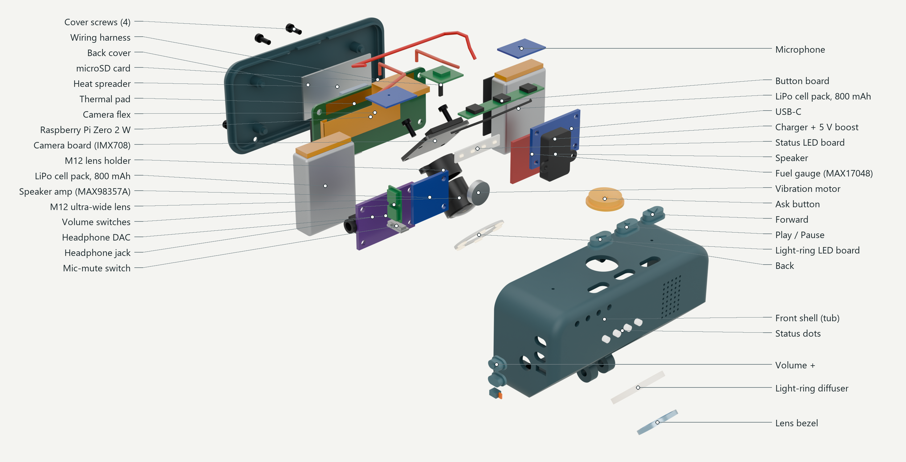 | 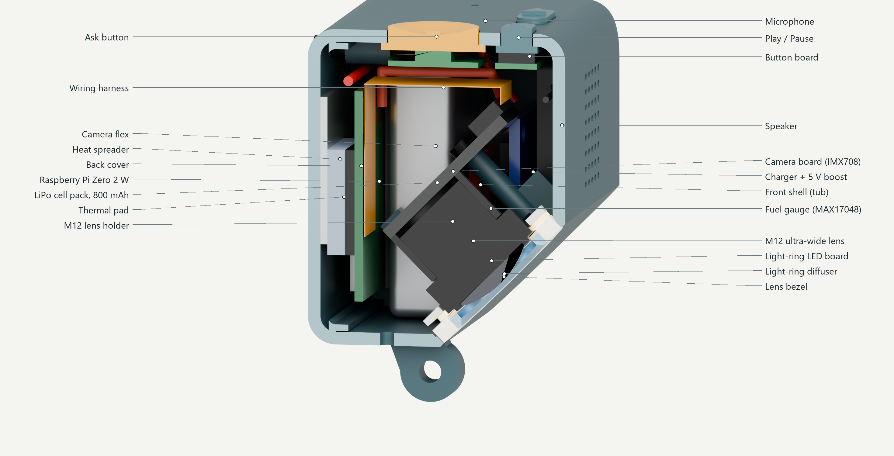 |
| 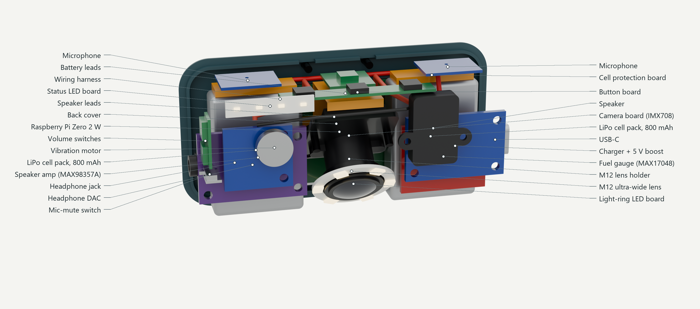 |  |

- **Model:** `cad/build_model.py` (CadQuery). Unit shell in two parts; lens bezel and light ring; Ask, Play/Pause, Back, Forward, volume and mic-mute controls; status dots; Raspberry Pi Zero 2 W; Arducam B0310 camera at 45° behind the lens facet; two LP902535 cell packs; speaker; amp, DAC with its headphone jack and two microphones; charger and boost board with USB-C; fuel gauge; status and light-ring LEDs; vibration motor; every cable route; tilt joint; two-stage stick with its cord; hub with two torsion springs and a sensor; two blades; rear leg with TPU pad.
- **Exports** in `cad/out/`: one STEP for the whole assembly, 89 part STEP files, 18 print-ready STL files (all watertight) with [print notes](cad/out/PRINT_NOTES.md), four blade DXF patterns, and a GLB for the web viewer.
- **Drawings** in `drawings/`: [SenseBook_drawings.pdf](drawings/SenseBook_drawings.pdf) and one PDF per part in `drawings/parts/`.
- **Reports:** [fit report](cad/out/FIT_REPORT.md) (tolerances, every touching pair, walls, cable routes, mass) and [source table](cad/SOURCES.md).
- **Pictures** in `renders/`: 15 renders. Front, side and top carry dimensions read from the model.
- **Hardware kit** in `prototype/hardware/`: [bill of materials](../prototype/hardware/Prototype_BOM.md) with the datasheet for each part, [pin map](../prototype/hardware/pinmap.md) and wiring diagram generated from the software's own pin table, [assembly guide](../prototype/hardware/Assembly_Guide.md), [test checklist](../prototype/hardware/Test_Checklist.md).
- **Viewer:** `design/viewer/`. Rotate, pull apart, make the shell see-through, click a part for its name.

| | | |
|---|---|---|
|  |  | 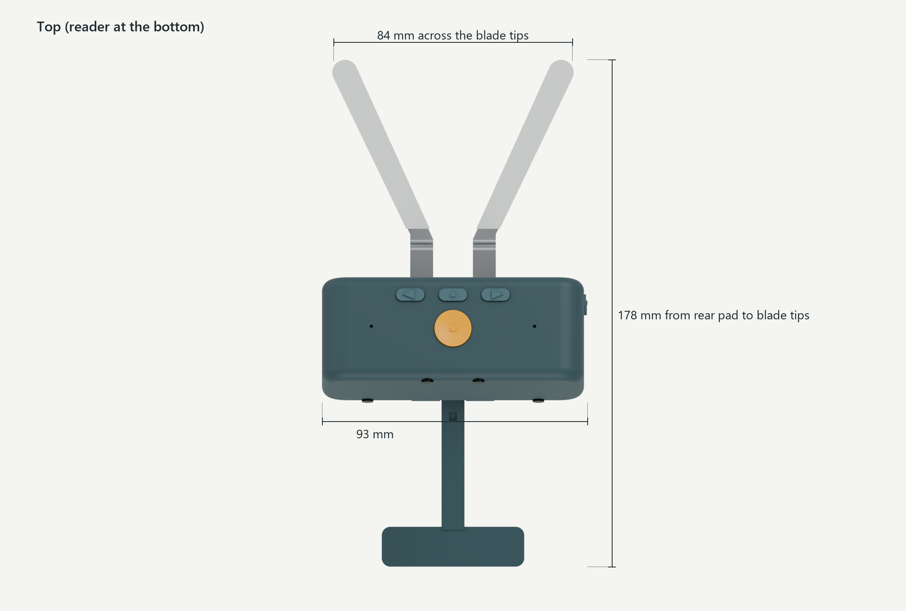 |
| 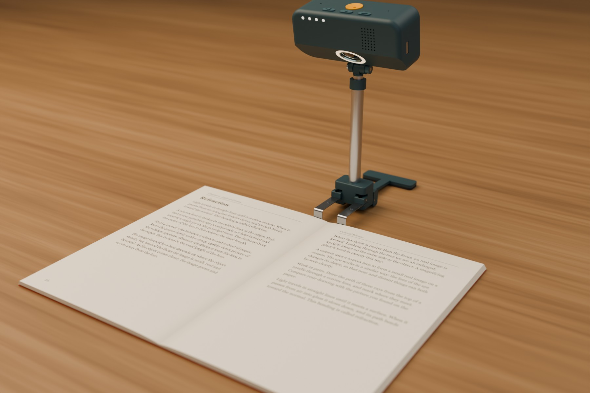 |  | 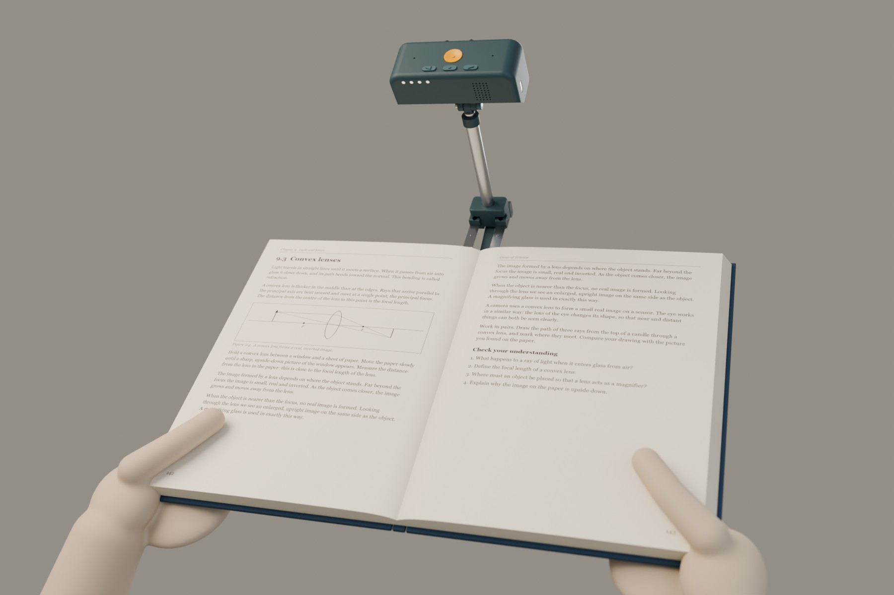 |
| 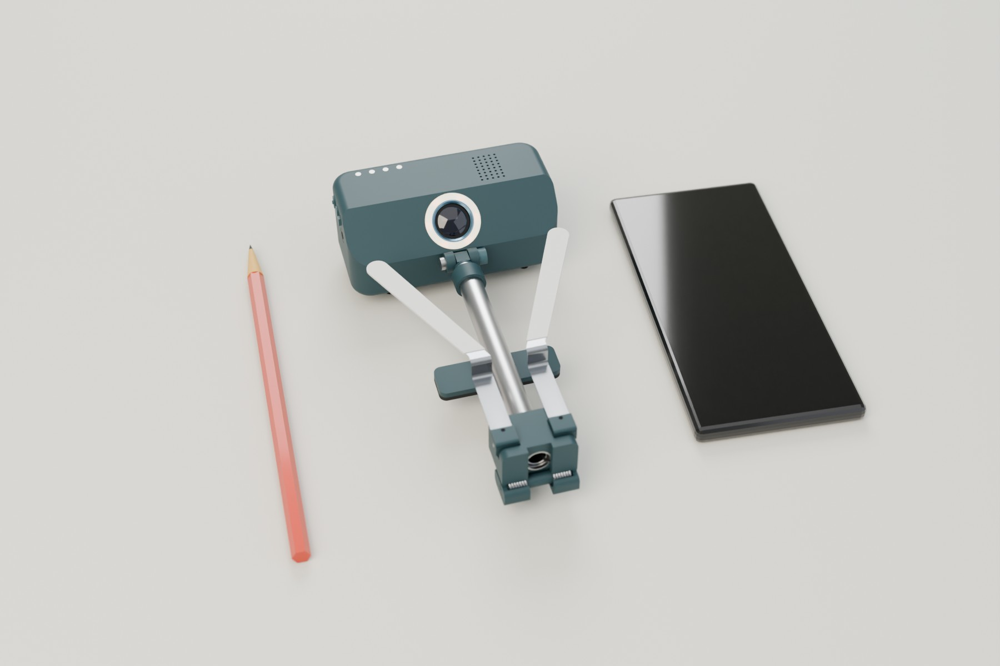 | 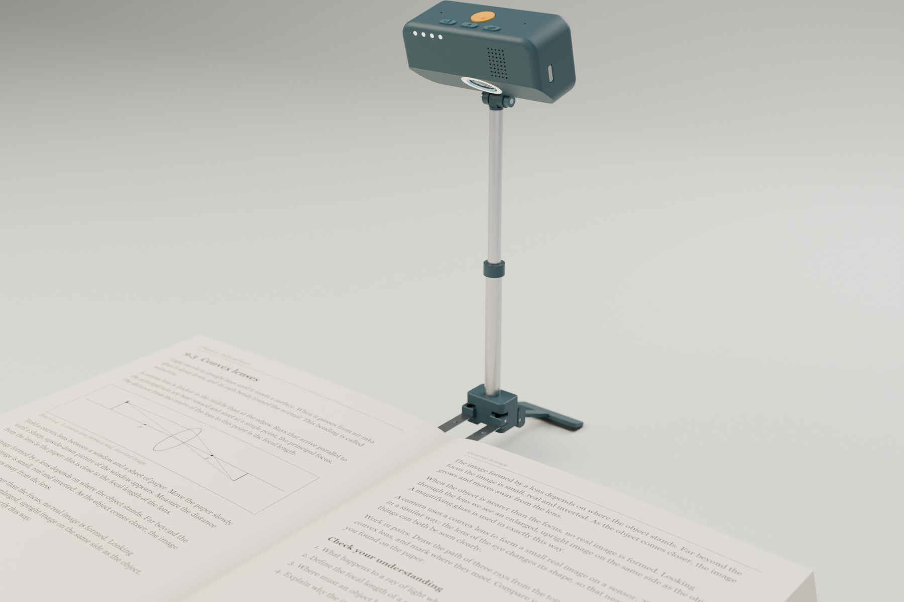 | 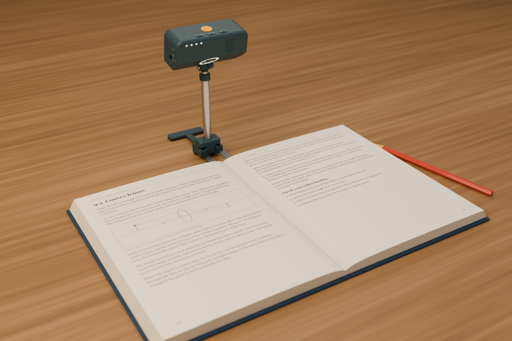 |

The hands in the "held" picture are plain mannequin stand-ins for scale. The books, table, pencil and phone are simple props made for the renders.

## 2. Where the sizes come from

Every bought part is drawn from a published source, in this order of trust: the maker's own drawing or 3D file, then the maker's board file or datasheet, then a product page. Nothing was guessed without saying so.

| Basis | Values |
|---|---|
| Labelled on the maker's drawing or datasheet | 75 |
| Measured on the maker's published 3D file (the camera) | 23 |
| Read from the maker's published board file | 21 |
| Measured from the 1:1 artwork inside a maker's drawing, not labelled (about ±0.1 mm) | 18 |
| Stated on a maker's or seller's product page | 26 |
| **EST: no source found** | **25** |

The 25 estimates, in short: the Pi's board thickness and the heights of its connectors and chips (the Raspberry Pi drawing gives outlines only); board thickness of the five breakout boards; the size of the jack on the DAC board; the height of the charger board and of the fuel gauge once its sockets are off; the lever width of the mute switch; four part masses; and the 8 mm tube, for which we found no confirmed seller. Each is in [SOURCES.md](cad/SOURCES.md) with the reason and how to measure it.

**No third-party 3D file is stored in this repository.** Raspberry Pi's STEP files may not be redistributed, Arducam's carries no stated licence, and KiCad's library is CC-BY-SA. Each part is modelled from its published dimensions and the source is cited.

## 3. Does it fit?

Checked by `cad/build_model.py` (exact solid intersections and exact minimum distances) and `cad/check_model.py`. The full tables are in the [fit report](cad/out/FIT_REPORT.md).

**Tolerances the model is drawn for**

| What | Value |
|---|---|
| Printed PETG part, general | ±0.2 mm |
| Sliding fit, printed (button caps, slider, cover tongue) | 0.15 mm clear per side |
| Steel pin in a drilled hole | 0.05 mm per side |
| Bought part to anything it must not touch | at least 0.3 mm |
| Cut sheet / cut tube and pin length / turned part | ±0.1 / ±0.2 / ±0.05 mm |

**Results**

| Check | Result |
|---|---|
| Clashes between the 89 bodies, assembled pose | **0** |
| Clashes between moving parts in 6 poses (hardcover, thin paperback, no book, in the hand, stick up, folded) | **0** |
| Pairs that touch or come within 0.5 mm | 144: 57 designed fits at their drawn clearance, 20 clear by 0.3 mm or more, 67 that touch or overlap on purpose (seated, glued, soldered, screwed) |
| Pairs tighter than drawn, or closer than 0.3 mm without being a designed fit | **0** |
| Cable routes (9) | 0 clashes. Camera flex 79 mm of a 150 mm cable; battery leads 85 mm; hub cord routed end to end |
| All 18 print files watertight | yes |
| Shell wall, front shell | median 1.8 mm; 0.7% of the surface under 0.8 mm |
| Shell wall, back cover | median 1.8 mm; the locating tongue is 0.9 mm |

**What changed to make the real parts fit**

- The unit grew by 4 mm in width, 5 mm in height and 3 mm in depth. Reasons are in [cad/README.md](cad/README.md).
- The lens window is gone: the real lens front sits in a bezel, 0.4 mm inside the facet.
- Two stock springs replace one imagined spring; the hub is 3 mm wider.
- The hub cord now has a real path: a hole and slot in the joint head, a hole in the bottom of the unit between the lugs, a groove in the hub and a notch in the foot of the tube.

**Flaws the checks found in the first model, now fixed.** The cord was drawn through the head of the tilt screw. The cover's locating tongue was a separate ring that touched nothing. The blade clamp screw sat 0.1 mm from the knuckle pin. Two walls in the hub were 0.2 mm thick. None of these showed as a clash, which is why the wall check and the route check were added.

## 4. What CAD cannot prove: measure on the first print

A printed part is good to about 0.2 mm, holes print small, and 25 part sizes are estimates. So the first print is a measuring exercise, not a build.

**Before printing anything:** buy one of each electronic part and measure it against [SOURCES.md](cad/SOURCES.md). Start with the camera, one cell pack, the DAC board and the fuel gauge.

**Print first:** the front shell, the back cover and the hub. They carry almost every fit. Then measure, with calipers and feeler gauges:

| Fit | Drawn | How to measure |
|---|---|---|
| Cover tongue in the front shell | 0.15 mm clear all round | Feeler gauge on four sides; the cover must seat flush |
| Button caps and mute slider in their openings | 0.15 mm per side | Each cap must drop back under its own weight |
| Lens opening and bezel | 24.0 mm opening; lens rim 0.2 mm clear in the bezel; lens front 0.4 mm inside the facet | Calipers; fit the camera and look square down the lens |
| Camera on two posts and two cradle ribs | Board flat on the posts, lower edge in the notches | Seat it; check the lens is square to the facet |
| Pi on four pins | 2.55 mm pins in 2.75 mm holes | Press the board on; it must lie flat |
| Cell pockets | 10.5 mm deep; 0.4 mm to the camera board; 3.5 mm above the packs | Slide both packs in with their foam |
| USB-C opening, headphone hole | 0.2 mm all round | Fit the boards and look from outside |
| DAC board | 0.3 mm to the wall and to the lower volume cap | Feeler gauge |
| Stick bore, pin holes, spring pockets in the hub | 10.16 mm bore; 2.0 and 1.6 mm pins; 8.0 mm pockets | Drill to size, try the tube, pins and springs |
| Lead groove and tube notch | 1.2 mm wide for a 0.9 mm lead | Lay the lead in; push the stick fully down |

The same list, with a result column, is section J of the [test checklist](../prototype/hardware/Test_Checklist.md).

**Not drawn at all, so it must be worked out on the first build:** the seats for the legs of the two torsion springs; the fold of the spare camera cable; the light-ring circuit board; a power switch.

## 5. Mass


| | grams |
|---|---|
| Product spec and venture plan | about 90 |
| First estimate in `sb_params.py` | 137 |
| **3D model with the real parts** | **about 167** (unit alone about 113) |

Printed and cut parts are volume times density. Bought parts use the published mass, or an estimate where none is published (camera, cell, charger, motor). `sb_params.MASS` now holds the model's figures, so `analysis.py` uses them too.

- **Shells and buttons, about 37 g.** A 1.8 mm PETG shell of this size.
- **Cells, 32 g** (estimate: the Akyga sheet gives no mass).
- **Stick, about 24 g.** The two stainless tubes weigh 22 g. In aluminium, as the product spec says, they would weigh about 7.5 g.
- **Hub with springs and pins, about 15 g.**

Nothing in this design gets near 90 g.

## 6. Stability, grip, springs and the camera

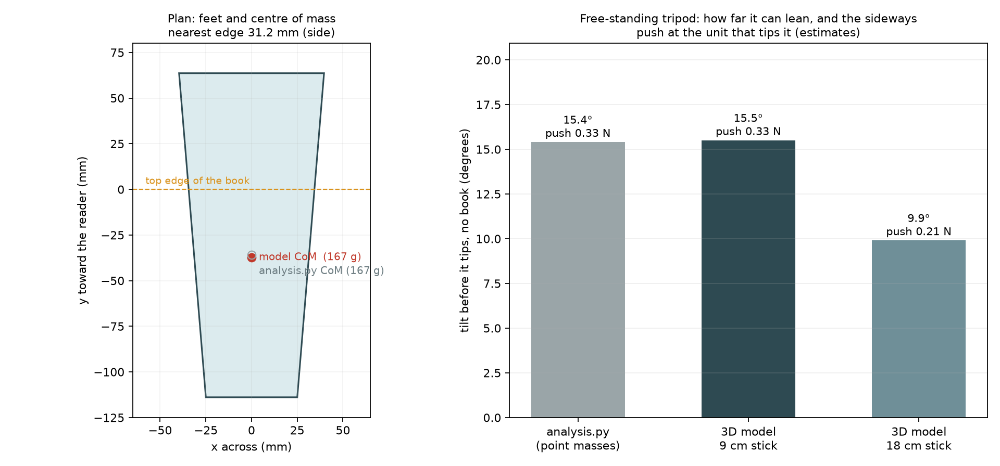

`analysis.py` was re-run with the new envelope, lens point and mass table. `check_model.py` repeats its formulas with the model's own centre of mass and feet.

| Case | Result |
|---|---|
| Free-standing, no book: tips at | **15.5°**, sideways first |
| Free-standing: sideways push at the unit that tips it | 0.33 N |
| Free-standing, stick at 18 cm | **9.9°**, 0.21 N |
| On a table with a book: backward / sideways push | 2.03 N / 0.61 N |
| In the hand at 45° / 90°: blade root stress | 275 / 377 MPa (shim yield about 965 MPa) |
| Lens above the page, 9 cm stick | 117 mm |
| Coverage margin, 37 x 24.5 cm spread | 3.5% |
| Detail at the reader's edge of the page | about 75 dpi |
| Rear-leg pad force, thin paperback / hardcover / 33 mm book | 3.8 / 3.3 / 2.5 N |

A 0.2 to 0.3 N push is very little: a sleeve or a turning page can deliver it.

**Springs.** The stock spring that fits (1.0 mm wire, 5.5 mm inside, 6.5 coils) is allowed 111.87 N·mm at 93.82°. The first analysis assumed 135 to 232 N·mm from one spring, which would overstress it. The model now has two, wound 20° when the leg first meets them at 110° of swing. On the thinnest book they reach 96% of their limit. Whether 2.5 to 3.8 N at the pad holds a book in a moving hand is untested.

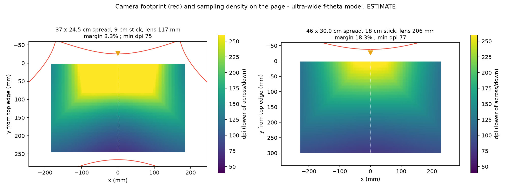

**Camera.** The maker states 120° across, 66.7° up and down and 152.2° corner to corner. `analysis.py` models the lens as an ideal 120° equidistant lens. Real distortion and corner sharpness are unknown until a page is photographed. Nothing stands in front of the lens now, so the bezel cannot shade the corners.

## 7. What the datasheets told us

1. **Battery.** We found no datasheet for a "102535" cell. The documented cell of that footprint, Akyga LP902535, is 800 mAh and allows 0.8 A. Two give 1,600 mAh and 1.6 A.
2. **Supply current.** The charger and boost board drawn in the model is listed at 1 A on its 5 V output. A Pi Zero 2 W with the speaker loud, the light ring on and the camera running may ask for more. This is test B5 and B6, and it is the first electrical thing to check.
3. **Spring torque.** See section 6.
4. **Headphone detect.** The DAC board carries its own jack. We could not confirm it has a plug-detect contact. A switched jack exists (CUI SJ-3524-SMT) if it does not.
5. **Fuel gauge.** 7.2 mm tall as sold. It fits only with its two sockets removed.
6. **Amp board.** Some versions carry a screw terminal block taller than the 3.0 mm drawn. Leave it off.
7. **Camera cable.** The stock cable is 150 mm; the route is 79 mm. The rest has to fold flat behind the Pi.
8. **Hub sensor.** In this model the switch is pressed when the rear leg is folded away. The software default reads it the other way round: `hardware.hub_active_low` must be `false` for this build.
9. **Tubes.** We found a seller page for 10 x 0.5 mm stainless tube, none we could confirm for 8 x 0.5 mm.
10. **Screws.** The cover and camera screws are ISO 7049 ST2.2 pan head (head 4.0 x 1.6 mm). DIN 7981 heads differ slightly.
11. **Local supply.** Most of the documented parts are not on sale in Dhaka. Eight lines in the [bill of materials](../prototype/hardware/Prototype_BOM.md) are a different make locally.

## 8. Software checks

Run earlier today, before the CAD was redrawn. Nothing in `prototype/software/` was changed.

| Check | Result |
|---|---|
| `python -m pytest -q` after `pip install -r requirements.txt` (the README's steps), Python 3.11, Windows | **54 passed, 1 skipped.** The hardware tests are skipped because `gpiozero` is only in `requirements-pi.txt`. |
| Same, after `pip install gpiozero` | **72 passed** |
| Offline demo: `python -m sensebook --mode dev --provider mock --fake-camera --silent --no-web`, keys fed from a script | Runs. Captured two spreads, followed a page turn, answered "where am I", refused an off-page question, started a quiz, switched to headphones, set the battery gauge. |
| Pin map against `hardware.py` | The pin map and wiring diagram are generated from `sensebook/config.py`, the table `hardware.py` imports. 16 GPIO functions, 4 I2S pins, 2 I2C pins. |

Not run here: any real Gemini call, any Raspberry Pi hardware, a real webcam, audio devices.

## 9. Documents against the repository

"Shared" means the file is outside this chat's area, so it is reported here and left unchanged.

| # | Where | It says | What is in the repository | Whose |
|---|---|---|---|---|
| 1 | README, product spec §3, venture plan §3 | Folds to a baton about 10 x 4 x 3.5 cm | Model folds to about 17.0 x 9.3 x 3.8 cm | Shared; owner decision |
| 2 | Product spec §3, venture plan §3 | About 90 g | Model about 167 g | Shared; owner decision |
| 3 | Product spec §3, venture plan §3 | Unit about 8.5 x 3.8 x 3 cm | Model: 92 x 45 x 37 mm, the smallest that holds the documented parts | Shared; owner decision |
| 4 | Product spec §3 | Aluminium stick | `sb_params.py`: stainless tube | Decide one; aluminium saves about 14 g |
| 5 | Product spec, venture plan | 2,000 mAh battery | Two documented 800 mAh packs: 1,600 mAh | Shared; owner decision |
| 6 | README | `python -m pytest -q   # 72 tests` | 54 passed, 1 skipped with the README's steps; 72 with `gpiozero` | Shared |
| 7 | Product spec §8 | 38 automated tests pass | 72 | Shared |
| 8 | Product spec §3, `tools/build_site.py` | `design/SenseBook_Industrial_Design.md` | Does not exist. This report, `cad/README.md`, the drawings and the renders cover the build side | Build chat, if the owner wants the document |
| 9 | `prototype/software/README.md` | "Lamp-shaped device"; camera tilted 23 to 26° from vertical, 1 cm behind the top edge; "mounted at 38 to 40 cm" | Tri-grip design: 34.5° from vertical, lens 27 mm behind the top edge, 117 mm above the page | Shared |
| 10 | Product spec §3 | Two microphones with echo cancellation | Two microphones in the wiring; no echo-cancellation code in `prototype/software/` | Shared |
| 11 | Product spec §7 | Memory in an encrypted local database | Plain SQLite file; no encryption in the code | Shared |
| 12 | Product spec §5 | Ask: tap repeats, double tap stops. Back and Forward: hold for paragraph | Ask is hold-to-talk only. Hold Back repeats; double tap Back is previous paragraph; Forward has no hold | Shared |
| 13 | `prototype/software/config.example.yaml` | `hub_active_low: true`, "closes to ground when clamped on a book" | The model's switch closes when the rear leg is folded away, and on a table the leg clamps nothing | Shared; decide the meaning, then set the flag |
| 14 | `prototype/software/docs/AUDIO.md` | Headphone detect on GPIO 7 from a switch in the jack | The jack in the model is the one on the DAC board; we could not confirm it has a detect contact | Shared; check on the bench |
| 15 | `tools/build_site.py` (hub site) | Links the validation report and print notes | Does not yet link the drawings, the fit report or the source table | Positioning and brand chat |

## 10. Open risks

Ordered by how much they could change the design. Every line is untested.

1. **Mass.** About 167 g against a 90 g promise. Whether that is comfortable on a hand-held book for an hour is unknown.
2. **Size.** The unit is 92 x 45 x 37 mm, larger than the documents say, and it cannot shrink while it holds these parts.
3. **Supply.** Most of the documented parts must be imported. If local parts are used instead, the unit has to be re-drawn around them and re-printed.
4. **Power.** 1,600 mAh, and a boost board listed at 1 A. A brown-out under load would need a different board, which would be a different size.
5. **Tip-over with the stick up.** About 9.9° and 0.21 N. The stick-up mode may need a wider foot or a table-only rule.
6. **Telescope.** 11.5 mm of overlap at 18 cm will wobble. A two-stage stick that is 9 cm long when closed cannot do better; three stages or a longer closed length can.
7. **Folded size.** About 17 cm long. The "baton" needs a redesign or a new description.
8. **Camera.** No sample yet. Far-edge detail of about 75 dpi is low for small print. Real distortion is unknown. Light-ring glare on glossy paper is not modelled.
9. **Heat.** The Pi sits in a closed PETG shell with one aluminium plate. No thermal model was run. The thermal pad thickness depends on a chip height nobody publishes.
10. **Rear-leg springs.** Two stock springs near their limit on thin books; their leg seats are not drawn; the pad force is small.
11. **Blades.** One blade shape does not suit every book: the step from hub to cover is 7.5 mm on the hardcover, 10 mm on a thin paperback and 25 mm on a 33 mm book. Real blades must flex that far or be swapped. Grip in a moving hand and catching on page corners are untested.
12. **Rear-leg pad.** In the hand it meets the spine about 10° off flat. It probably needs a pivoting foot.
13. **Hub cord.** About 10 mm of free cord bends every time the unit tilts; 2 mm of height for the lead under the inner tube; a hand-wound coil that must stretch by 90 mm.
14. **Speaker beside the microphones**, with no echo cancellation in the software.
15. **Printability.** The camera posts are 3.2 mm across and about 14 mm long; the cover tongue is 0.9 mm; the hub has a 1.2 mm groove and needs supports. Thin spots are listed per part in the fit report. Two are known and harmless: a feather edge under 0.3 mm thick and 1 mm tall behind the foot of the stick bore in the hub, and the two spring pockets, which break out through the lower front corner of the hinge block. Neither will print cleanly; neither carries load.
16. **No power switch** has a place in the model. The light-ring board has no circuit layout.
17. **Battery life** is not modelled here.

## 11. What is left, and why

| Left | Why |
|---|---|
| Buy one of each part and measure the 25 estimates | No source gives them. A wrong estimate can move a wall. |
| Print the two shells and the hub, and measure the fits in section 4 | Only a print proves a fit. |
| Then print the rest, build one unit and run the [test checklist](../prototype/hardware/Test_Checklist.md) | Needs a printer, parts and a bench. Every number above is waiting on this. |
| Decide rows 1 to 5 and 13 of the table in section 9 | They are product decisions, not modelling ones. |
| Correct the README, product spec, venture plan and software files | Shared files: the build chat reports, the owner or the right chat edits. |
| Link the drawings, fit report and source table on the hub site | `tools/build_site.py` belongs to the positioning and brand chat. |
| Draw the spring seats, a power switch and the light-ring board | Left out today; each needs a part on the bench to draw well. |
| Strength and thermal analysis | Not done: the model is geometry only. Worth doing after the first print shows what changes. |
| `design/SenseBook_Industrial_Design.md` | Cited by the spec; never written. Say if it is wanted. |

## How to repeat this

```bash
cd design/cad
../.venv/Scripts/python build_model.py     # model, clash and clearance checks, CAD files
../.venv/Scripts/python analysis.py        # geometry checks
../.venv/Scripts/python check_model.py     # fit report, source table, print notes
../.venv/Scripts/python make_drawings.py   # PDF drawings
cd ../../prototype/software && python -m pytest -q
```

Full set-up is in [cad/README.md](cad/README.md). Raw numbers: [`cad/out/model_report.json`](cad/out/model_report.json) and [`cad/out/check_report.json`](cad/out/check_report.json).
