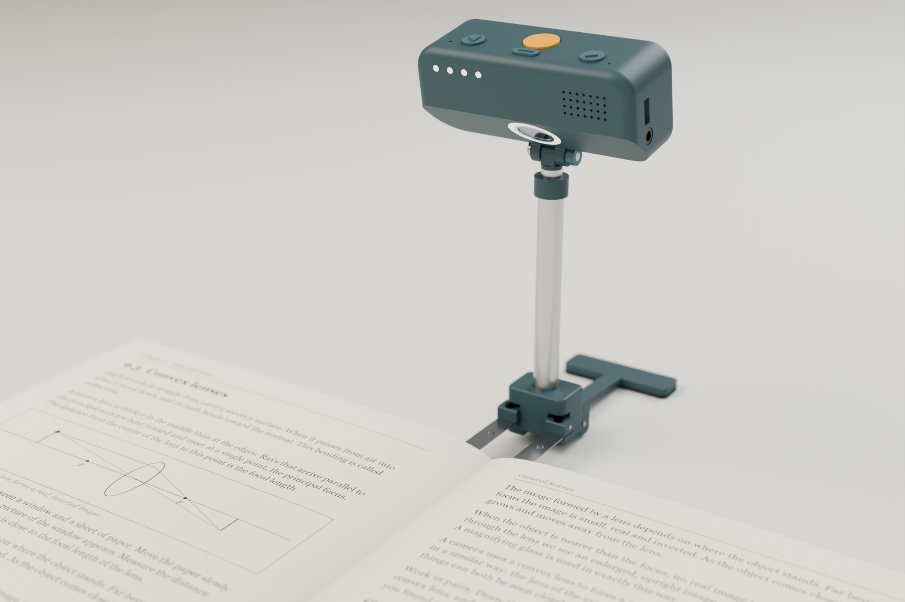
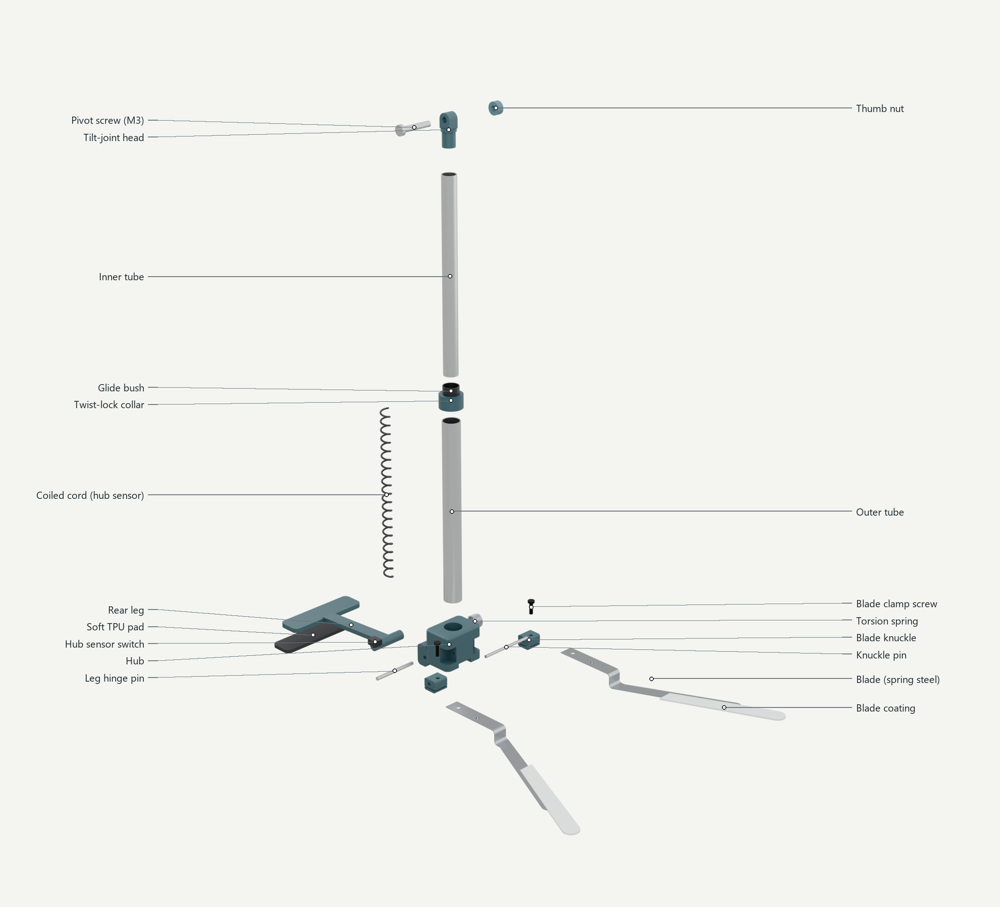
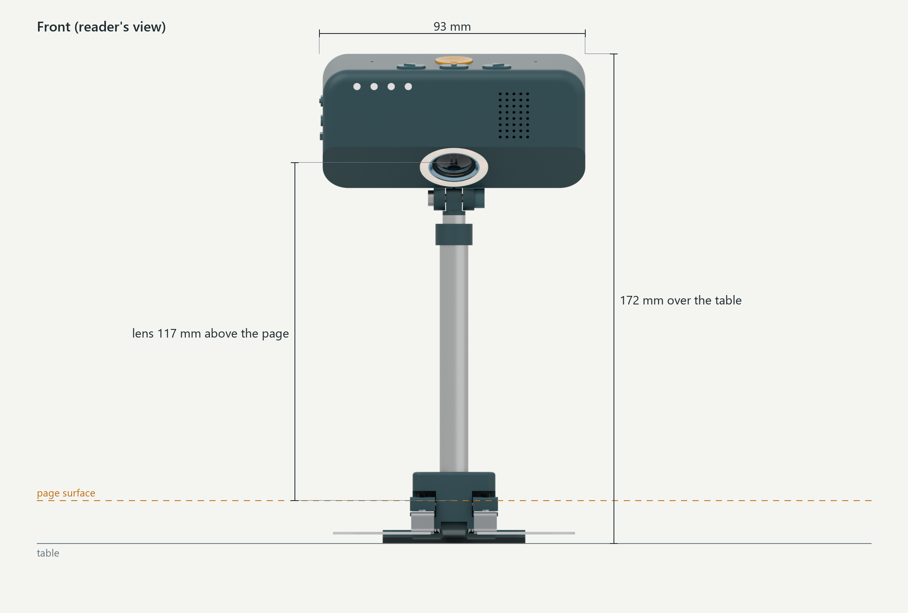
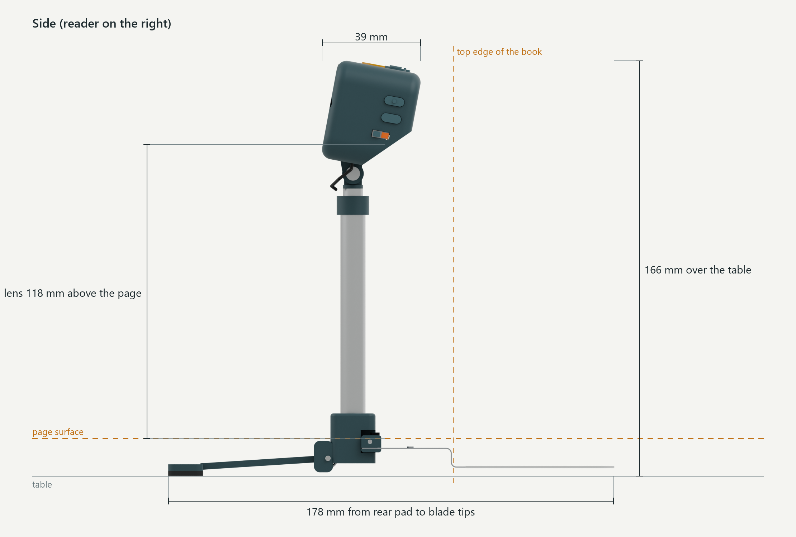
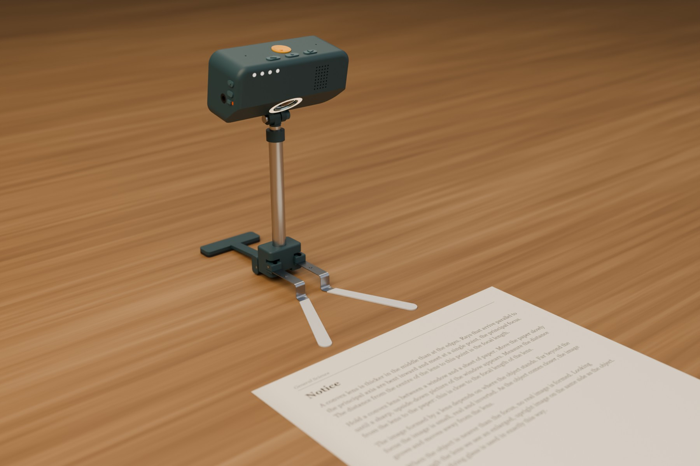
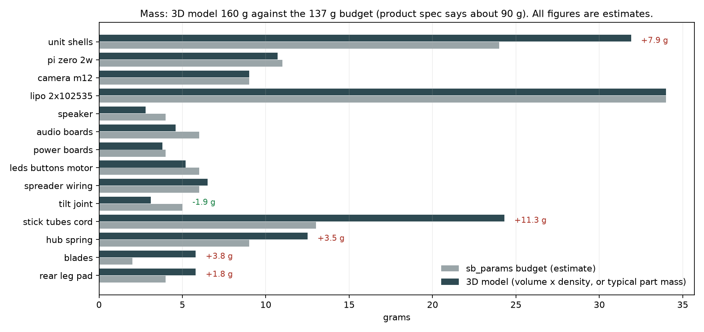

# SenseBook: 3D build and project validation

27 November 2026 · build chat · covers `design/`, `prototype/hardware/`, the viewer, and a check of the whole repository against itself.

> **Read this first.** Everything here comes from a CAD model and from scripts. **No part has been printed, assembled or measured.** Masses, forces, angles and prices are estimates. The pictures are renders of the model, not photographs. Market, pricing and legal questions are in [docs/validation/](../docs/validation/README.md), not here.



## The result on one screen

| Question | Answer | Status |
|---|---|---|
| Is there a complete 3D model? | Yes. 88 separate bodies, built by script from `sb_params.py`. | Done |
| Does everything fit in the 88 x 40 x 34 mm unit? | Yes, with **no collisions** in six poses, but with several gaps under 1.5 mm. | Fits on paper; tight |
| Does it weigh what the documents say? | **No.** Model: about **160 g**. `sb_params.py`: 137 g. Product spec and venture plan: about 90 g. | Mismatch |
| Does it fold to a 10 x 4 x 3.5 cm baton? | **No.** It folds to about **16.5 x 8.9 x 3.6 cm**. A 9 cm stick cannot fold into 10 cm. | Mismatch |
| Does the camera still see a whole textbook spread? | Yes. 3.6% margin with the lens where the model puts it (analysis: 3.1%). Far-edge detail is still low, about 74 dpi. | Holds; low detail at the far edge |
| Does it stand as a tripod? | At 9 cm it tips at about 15.6° (analysis: 13.8°). With the stick at 18 cm it tips at about **9.9°**. | Holds at 9 cm; weak at 18 cm |
| Does the stick reach 18 cm? | Only with 12.5 mm of tube overlap, which is short. | At risk |
| Do the software tests pass? | 72 pass once `gpiozero` is installed. With the README's own steps: 54 pass, 1 skipped. The offline demo runs. | Pass, README step missing |
| Do the documents match the repository? | 14 mismatches found, listed in section 6. | Needs owner decisions |

## 1. What was built

| | |
|---|---|
|  |  |
|  |  |

- **Model:** `cad/build_model.py` (CadQuery). Unit shell in two parts; lens window, bezel and light ring; Ask, Play/Pause, Back, Forward, volume and mic-mute controls; status dots; Pi Zero 2 W; M12 camera at 45° behind the lens facet; two 102535 cells; speaker; amp, DAC and two microphones; charger and boost board with USB-C; fuel gauge; status and light-ring LEDs; vibration motor; headphone socket; main wiring routes; tilt joint; two-stage stick with its cord; hub with torsion spring and sensor; two blades; rear leg with TPU pad.
- **Exports** in `cad/out/`: one STEP for the whole assembly, 88 part STEP files, 18 print-ready STL files (all watertight) with [print notes](cad/out/PRINT_NOTES.md), four blade DXF patterns, and a 4 MB GLB for the web viewer.
- **Pictures** in `renders/`: 15 renders. Front, side and top carry dimensions read from the model.
- **Hardware kit** in `prototype/hardware/`: [bill of materials](../prototype/hardware/Prototype_BOM.md), [pin map](../prototype/hardware/pinmap.md) and wiring diagram generated from the software's own pin table, [assembly guide](../prototype/hardware/Assembly_Guide.md), [test checklist](../prototype/hardware/Test_Checklist.md).
- **Viewer:** `tools/viewer/` is added to the hub by `tools/build_site.py`. Rotate, pull apart, make the shell see-through, click a part for its name.

| | | |
|---|---|---|
|  |  |  |
|  |  |  |
|  |  |  |

The hands in the "held" picture are plain mannequin stand-ins for scale. The books, table, pencil and phone are simple props made for the renders.

## 2. Does it fit?

Checked by `cad/build_model.py` (exact solid intersections) and `cad/check_model.py`.

| Check | Result |
|---|---|
| Collisions between the 88 bodies, default pose | 0 |
| Collisions between moving groups in 6 poses (hardcover, thin paperback, no book, in the hand, stick up, folded) | 0 |
| Gaps under 0.5 mm that are not designed fits | see the tight spots below |
| Shell wall, front shell | median 1.8 mm; 5% of the surface under 1.41 mm (hole edges, camera posts) |
| Shell wall, back cover | median 1.8 mm; 5% under 0.9 mm (the 0.9 mm locating tongue) |
| All 18 print files watertight | yes |

**Tight spots** (model clearance, not measured):

| Where | Gap |
|---|---|
| Cells, lengthwise, inside a 36.4 mm tall cavity | 1.4 mm in total for a 35.0 mm cell. A real cell with its protection board is often 36 to 37 mm long. |
| Camera board to each cell / to the Pi | 0.6 mm / 1.2 mm |
| Cells to the shell at the rounded corners | 0.4 mm |
| Pi's HDMI and USB shells to the back cover | 0.1 mm |
| Wiring harness past the two top cover screws | 0.1 mm |
| Pi held on four locating pins, not screws | There is no room for screw heads between the Pi and the cells. |

## 3. Mass



| | grams |
|---|---|
| Product spec and venture plan | about 90 |
| `sb_params.py` budget | 137 |
| **3D model** | **about 160** (unit alone about 109) |

Where the extra 23 g over the budget comes from:

- **Stick tubes, +11 g.** Two stainless tubes that run through the hub weigh 22 g. The same tubes in aluminium (as the product spec says) would weigh about 8 g.
- **Shells, +8 g.** A 1.8 mm PETG shell of this size weighs about 29 g; with buttons and lens parts 32 g. The budget has 24 g.
- **Blades, +4 g.** Two 0.4 x 8 mm steel blades about 115 mm long weigh 5.8 g. The budget has 2 g.
- **Hub, +3.5 g.**

Printed parts use volume times density. Bought parts use typical part masses. Aluminium tubes and a 1.4 mm wall would bring the total to roughly 135 to 140 g (estimate). Nothing in this design gets near 90 g.

## 4. Stability, grip and the camera


`analysis.py` was re-run unchanged; its results file is identical to the committed one. `check_model.py` then repeats its formulas with the model's mass, centre of mass and feet.

| Case | `analysis.py` (137 g) | 3D model (160 g) |
|---|---|---|
| Free-standing, no book: tips at | 13.8° | **15.6°**, sideways first |
| Free-standing: sideways push at the unit that tips it | 0.27 N | 0.32 N |
| Free-standing, stick at 18 cm | not computed | **9.9°**, 0.20 N |
| On a table with a book: backward / sideways push | 1.64 N / 0.57 N | 2.08 N / 0.62 N |
| In the hand at 45°: blade root stress | 251 MPa | 262 MPa |
| In the hand at 90° | 348 MPa | 358 MPa |
| Lens above the page, 9 cm stick | 116.2 mm | 117.3 mm (the lens sits 1.4 mm behind the window) |
| Coverage margin, 37 x 24.5 cm spread | 3.1% | 3.6% |
| Detail at the reader's edge of the page | 74 dpi | unchanged |

The model is heavier but its weight sits lower (heavier tubes and hub), so the tripod is slightly steadier than the analysis said. A 0.2 to 0.3 N push is still very little: a sleeve or a turning page can deliver it.


**New from the model:** to see the page corners the lens needs a clear field of 59.5° off its axis. The bezel in front of the lens passes that only if the lens's entrance pupil sits less than about 2 mm behind its front glass. That depth is unknown until a lens sample is on the bench. If it is deeper, open the bezel from 12.6 mm to 15 mm.

## 5. Software checks

| Check | Result |
|---|---|
| `python -m pytest -q` after `pip install -r requirements.txt` (the README's steps), Python 3.11, Windows | **54 passed, 1 skipped.** The hardware tests are skipped because `gpiozero` is only in `requirements-pi.txt`. |
| Same, after `pip install gpiozero` | **72 passed** |
| Offline demo: `python -m sensebook --mode dev --provider mock --fake-camera --silent --no-web`, keys fed from a script | Runs. Captured two spreads, followed a page turn, answered "where am I", refused an off-page question, started a quiz, switched to headphones, set the battery gauge. |
| Pin map against `hardware.py` | The pin map and wiring diagram are generated from `sensebook/config.py`, the table `hardware.py` imports. 16 GPIO functions, 4 I2S pins, 2 I2C pins. |

Not run here: any real Gemini call, any Raspberry Pi hardware, a real webcam, audio devices.

## 6. Documents against the repository

"Shared" means the file is outside this chat's area, so it was reported here and left unchanged.

| # | Where | It says | What is in the repository | Whose |
|---|---|---|---|---|
| 1 | README, product spec §3, venture plan §3 | Folds to a baton about 10 x 4 x 3.5 cm | Model folds to about 16.5 x 8.9 x 3.6 cm | Shared; owner decision |
| 2 | Product spec §3, venture plan §3 | About 90 g | `sb_params.py` 137 g; model about 160 g | Shared; owner decision |
| 3 | Product spec §3, venture plan §3 | Unit about 8.5 x 3.8 x 3 cm | `sb_params.py` and model: 88 x 40 x 34 mm | Shared |
| 4 | Product spec §3 | Aluminium stick | `sb_params.py`: stainless tube | Decide one; aluminium saves about 14 g |
| 5 | README | `python -m pytest -q   # 72 tests` | 54 passed, 1 skipped with the README's steps; 72 with `gpiozero` | Shared |
| 6 | Product spec §8 | 38 automated tests pass | 72 | Shared |
| 7 | Product spec §3, `tools/build_site.py` | `design/SenseBook_Industrial_Design.md` | Does not exist. This report, `cad/README.md` and the renders cover the build side | Build chat, if the owner wants the document |
| 8 | README, venture plan §9 | CAD, print files, renders and `prototype/hardware/` are in the repository | True from this commit; they were missing before | Fixed |
| 9 | `prototype/software/README.md` | "Lamp-shaped device"; camera tilted 23 to 26° from vertical, 1 cm behind the top edge; "mounted at 38 to 40 cm" | Tri-grip design: 34.5° from vertical, lens 27 mm behind the top edge, 117 mm above the page | Shared |
| 10 | Product spec §3 | Two microphones with echo cancellation | Two microphones in the wiring; no echo-cancellation code in `prototype/software/` | Shared |
| 11 | Product spec §7 | Memory in an encrypted local database | Plain SQLite file; no encryption in the code | Shared |
| 12 | Product spec §5 | Ask: tap repeats, double tap stops. Back and Forward: hold for paragraph | Ask is hold-to-talk only. Hold Back repeats; double tap Back is previous paragraph; Forward has no hold | Shared |
| 13 | Product spec, venture plan | 2,000 mAh battery | Two 102535 cells, typically 900 to 1,000 mAh each (estimate). No 102535 cell found on sale in Bangladesh | Check with a real cell |
| 14 | `prototype/software/` hub sensor | "Attached" means clamped on a book | On a table the rear leg rests on the table and clamps nothing. The model's switch reads "rear leg deployed" instead | Decide the meaning |

## 7. Open risks

Ordered by how much they could change the design. Every line is untested.

1. **Mass.** About 160 g against a 90 g promise. Whether that is comfortable on a hand-held book for an hour is unknown.
2. **Cells.** 1.4 mm of spare length, and the size is not sold locally. A longer cell forces a taller unit.
3. **Tip-over with the stick up.** About 9.9° and 0.20 N. The stick-up mode may need a wider foot or a table-only rule.
4. **Telescope.** 12.5 mm overlap at 18 cm will wobble. A two-stage stick that is 9 cm long when closed cannot do better; three stages or a longer closed length can.
5. **Folded size.** About 16.5 cm long. The "baton" needs a redesign or a new description.
6. **Camera.** No lens sample yet. Far-edge detail of 74 dpi is low for small print. The bezel may shade the corners. The camera board's real size is not confirmed against a 24 x 25 mm space. Light-ring glare on glossy paper is not modelled.
7. **Heat.** The Pi sits in a closed PETG shell with one aluminium plate. No thermal model was run.
8. **Blades.** One blade shape does not suit every book: the step from hub to cover is 7.5 mm on the hardcover, 10 mm on a thin paperback and 25 mm on a 33 mm book. Real blades must flex that far or be swapped. Grip in a moving hand and catching on page corners are untested.
9. **Rear-leg pad.** In the hand it meets the spine about 14° off flat. It probably needs a pivoting foot.
10. **Speaker beside the microphones**, with no echo cancellation in the software.
11. **Printability.** Camera posts are 3.2 mm across and 15 mm long; the cover tongue is 0.9 mm; the hub needs supports. Nothing has been printed.
12. **Parts.** Seven items in the bill of materials need a size check against the model before buying.
13. **Cord through the tilt joint.** It bends every time the unit is tilted. No strain relief is designed.
14. **Battery life** is not modelled here. The product-validation report estimates 4 to 6.5 hours.

## 8. What is left, and why

| Left | Why |
|---|---|
| Print, build and run the [test checklist](../prototype/hardware/Test_Checklist.md) | Needs a printer, parts and a bench. Every number above is waiting on this. |
| Order one camera with the M12 lens and measure it | It sets coverage, the bezel size and the space behind the facet. No local source. |
| Decide rows 1, 2, 4 and 14 of the table in section 6 | They are product decisions, not modelling ones. |
| Correct the README, product spec, venture plan and software README | Shared files: the build chat reports, the owner or the right chat edits. |
| Publish the hub site with the viewer | Waits for the owner's yes. |
| Strength, thermal and tolerance analysis | Not done: the model is geometry only. Worth doing after the first print shows what changes. |
| `design/SenseBook_Industrial_Design.md` | Cited by the spec; never written. Say if it is wanted. |

## How to repeat this

```bash
cd design/cad
../.venv/Scripts/python analysis.py        # geometry checks
../.venv/Scripts/python build_model.py     # model, collisions, CAD files
../.venv/Scripts/python check_model.py     # model against analysis.py -> out/check_report.json
cd ../../prototype/software && python -m pytest -q
```

Full set-up is in [cad/README.md](cad/README.md). Raw numbers: [`cad/out/model_report.json`](cad/out/model_report.json) and [`cad/out/check_report.json`](cad/out/check_report.json).
