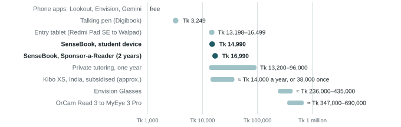
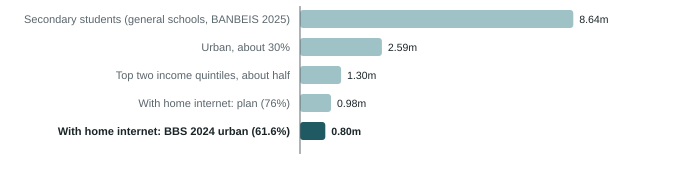
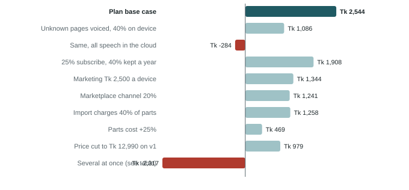
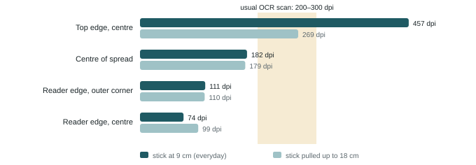
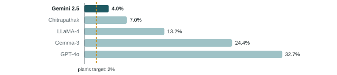
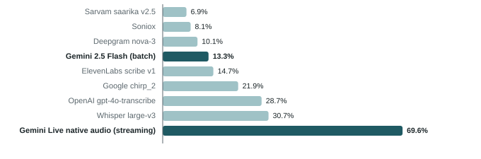

# SenseBook validation report

**Does the product, its use cases and the plan around them hold up?** A desk validation of the SenseBook venture plan, product spec and financial model (all v1.0, 26 November 2026).

- **Date:** 27 November 2026.
- **Method:** published sources only, each listed with its date, plus a re-run of the plan's own model.
- **Status:** nobody has been interviewed and no SenseBook hardware has been tested. Every SenseBook-specific number below is either the plan's assumption or our estimate, and is marked as such.
- **Companion files:** [the designed PDF](SenseBook_Validation_Report.pdf), [the claims register](Claims_and_Assumptions.md), [the validation kit](kit/), [positioning inputs](positioning-inputs.md).

---

## The verdict

> **Change, then test. Don't tool hardware yet.**
>
> **The need is real; the hard parts are unproven.**
> - Students in exam years lean on tutors and guidebooks.
> - Blind readers struggle to aim phone cameras.
> - Spaced quizzes and guided hints are well-evidenced ways to learn.
>
> **The plan claims more than the evidence supports:**
> - reading any print accurately;
> - understanding spoken Bangla questions;
> - AI at Tk 113 a month;
> - grants of Tk 43 lakh in Year 1;
> - a margin thin enough that one bad assumption wipes out the profit on each device.
>
> **The free phone in the house is the real rival, and so are new Bangla AI tablets.**
>
> **One blocker needs fixing now:** Google's terms forbid using Gemini, the plan's AI provider, in any service likely to be used by under-18s.
>
> **Re-scope the promise** to the student's own NCTB textbook, read from verified text and quizzed. Then run three cheap tests before spending pilot money.

| | |
|---|---|
| **What holds** | The study-help need, and the price families already pay for it. The offline, verified-text design for NCTB pages. Spaced quizzes and guide-don't-solve, both backed by evidence. Hands-free reading for blind users, who can't easily aim a phone. A price below every dedicated reader for blind people. A stable Pi Zero 2 W price. |
| **What doesn't hold** | Gemini as the AI provider for children: Google's terms bar under-18 services. NCTB rights treated as low risk: a 1980 law also bars unauthorised textbook explanations. The data law the plan cites, which has since been replaced. Accurate reading of unfamiliar print. Bangla speech recognition sent straight to the AI. The AI cost (voice for unfamiliar pages is missing). Year-1 grants. Several market labels. Subscription take-up and retention. A hardware margin with no room for error. "Blind students can't read their textbooks", because free talking textbooks exist. |
| **Test first** | 1. **The phone test:** do families prefer SenseBook to a phone on a stand, and will they pay a deposit? 2. **The Bangla reading test:** reading, voice and speech accuracy at the device's real camera view. 3. **The blind-reader and sponsor test:** can blind readers attach and read alone, and will two funders commit in writing? |

### Four numbers to remember
| Number | What it means | Source |
|---|---|---|
| **76.5%** | of secondary students had private tutors or coaching in 2023 | Education Watch 2023 (CAMPE), [The Daily Star, 30 Mar 2024](https://www.thedailystar.net/node/3578376) |
| **75.1%** | of households have a smartphone, so the rival is already in the house | BBS ICT survey, Apr–Jun 2026, [The Daily Star, 20 Sep 2026](https://thedailystar.net/news/technology/news/mobile-phone-use-reaches-896-bangladesh-bbs-4278021) |
| **74 dpi** | camera resolution at the reader's edge of a textbook spread, against the 200–300 dpi OCR normally uses | SenseBook design analysis, `design/cad/out/analysis_results.json` |
| **~4%** | best published AI character error on Bangla document scans, against the plan's ≤2% target | IndicVisionBench, [arXiv 2511.04727, Nov 2025](https://arxiv.org/html/2511.04727) |

---

## 1. What the plan rests on

**Takeaway: the plan stands on about 60 claims. Most of the commercial ones (attach rate, retention, marketing cost, volumes, grants) are assumptions with no outside evidence yet. The plan says so honestly.**

The full register, with a verdict for every claim, is in [Claims_and_Assumptions.md](Claims_and_Assumptions.md). In short:

| Question | The plan's answer | Verdict |
|---|---|---|
| **Who buys** | Parents of Class 6–10 NCTB students (revenue engine); private schools (Tk 11,490 + Tk 1,990 a year); sponsors for blind readers (Tk 16,990) | Parents: **holds**, but a narrower top-income group. Schools: **unsupported**. Sponsors: **weak**, no Bangladeshi precedent |
| **Who uses** | Class 6–10 students studying alone in the evening; blind and low-vision students and adults | **Holds**. The blind-student group is small (about 35,000–40,000 blind children) |
| **Why** | Stuck alone at night; tutors cost a lot; braille books late; phone apps need aiming; power cuts | **Holds**, but free DAISY talking textbooks already cover Classes 1–10 for blind students |
| **At what price** | Device Tk 14,990 (Tk 7,990 pilot); Learn Plus Tk 399 a month; Access Tk 16,990 | Device: **holds** at entry-tablet level. Subscription: **weak**. Access: **weak** |
| **How often** | 45 minutes a day, 26 days a month, 12 spoken questions an hour; 45% subscribe; 60% stay a year | **Unsupported**: no benchmark found |
| **Against what** | Gemini or ChatGPT on a phone, tutors, talking pens, OrCam and Envision, Chinese pens | **Weak**: misses EduTab, 10 Minute School AI, Lookout, DAISY books, guidebooks, Kibo |
| **Through which channel** | Facebook and Instagram, bKash and Nagad, cash on delivery, Rokomari, schools, Access partners, diaspora | **Unsupported**: no conversion or cost data yet |

---

## 2. The use cases, from three sides

**Takeaway: SenseBook is strongest where it reads the student's own NCTB textbook from verified text and quizzes them on it. It is weakest where it has to read unfamiliar print or understand open spoken Bangla, which is where the plan's Access story leans hardest.**

Scores are our judgement from the evidence: ●●●●● strong, ●○○○○ weak. "Payers" means parents, schools and funders.

| Use case | Need: students | Need: blind and low-vision | Need: payers | Best alternative today | SenseBook fit | Verdict |
|---|---|---|---|---|---|---|
| **Read a textbook page aloud, faithfully** | ●●○○○ | ●●●●○ | ●●●○○ | DAISY talking textbooks (free, blind students); reading it yourself; NotebookLM audio | ●●●●○ on indexed NCTB pages | **Strong** (for NCTB pages) |
| **Explain and discuss a page (Bangla and English)** | ●●●●● | ●●●●○ | ●●●●○ | Tutors and coaching; guidebooks; Gemini, Shikho AI, 10 Minute School AI | ●●●○○ | **Promising, unproven** |
| **Quizzes, spaced repetition, reminders** | ●●●●○ | ●●●○○ | ●●●●○ | Coaching tests; 10 Minute School daily MCQs; guidebook question banks | ●●●●○ | **Strong** (best evidence) |
| **Read unfamiliar books and small print** | ●●○○○ | ●●●●● | ●●●○○ | Google Lookout, Envision (free, list Bengali); sighted helpers | ●○○○○ | **Weak** for now |
| **In the hands, on a bus, at a table; earbuds; blind readers attaching it alone** | ●●●○○ | ●●●●● | ●●○○○ | Holding a phone; Kibo-style desk readers | ●●●○○ hands-free is the edge, untested | **Promising, untested** |

### 2.1 Reading a textbook page aloud, faithfully
- **Students:** read-aloud helps students with reading difficulties (d = 0.35, [Wood et al. 2018](https://pmc.ncbi.nlm.nih.gov/articles/PMC5494021)), but gives a "trivial" benefit to typical readers ([Clinton-Lisell 2023](https://files.eric.ed.gov/fulltext/EJ1403866.pdf)). Parents won't pay for read-aloud alone.
- **Blind and low-vision readers:** the need is high, but a free alternative exists. YPSA and a2i made DAISY talking textbooks for Classes 1–10, and NCTB has offered them free through an app and its website since January 2023 ([BSS, Dec 2022](https://www.bssnews.net/news/98326); [YPSA](https://ypsa.org/accessible-reading-materials-for-the-students-with-visual-and-print-disabilities)). Braille books are free but late and scarce. The braille code for maths and science was only approved in 2024 ([TBS, 23 Apr 2025](https://www.tbsnews.net/node/1124151)).
- **How well SenseBook would do it:** this is the design's best part. Known pages are matched on the device and read from verified text and pre-made audio, so there are no AI reading errors, no running cost and no need for internet.
- **What could make it fail:**
  - page recognition below about 97% in home light;
  - a voice people don't want to hear for 30 minutes;
  - printed editions that differ from the indexed PDFs;
  - for blind students, "the DAISY book already does this".
- **Cheap test:** bench test T1 (page recognition) and T2 (voices) in the kit. A blind reader compares SenseBook with the DAISY book on the same chapter.

### 2.2 Explaining and discussing a page in Bangla and English
- **Students:** the need is the strongest in the plan.
  - 76.5% of secondary students had tutors or coaching in 2023, and 93% used commercial guidebooks ([Education Watch 2023](https://www.thedailystar.net/node/3578376)).
  - Families spent Tk 27,340 a year per Class 9 student in 2022 (same source).
  - In Dhaka, tutors and coaching cost Tk 4,000–8,000 a month ([Dhaka Tribune, 23 Aug 2026](https://www.dhakatribune.com/bangladesh/education/418170/why-coaching-remains-a-%E2%80%98second-shift%E2%80%99-for)).
- **What people use today:**
  - Tutors and coaching; guidebooks as answer keys.
  - Gemini, which speaks Bengali and can use the camera, free (AI Plus Tk 600 a month, free for a year for students) ([gemini.google/bd](https://gemini.google/bd/subscriptions/?hl=en)).
  - Shikho AI and 10 Minute School's "AI Super Solve".
  - Shikho's **EduTab**, a Walton tablet with lessons and AI help, launched December 2025 ([Dhaka Tribune, 1 Dec 2025](https://www.dhakatribune.com/business/397749/shikho-walpad-launch-edutab)).
  - NotebookLM, which makes Bengali audio overviews from the free NCTB PDFs.
- **How well SenseBook would do it:** grounding answers in the current page is a real plus. Structured, hint-first tutoring is what the evidence backs:
  - Nigeria: +0.23 SD in 6 weeks ([World Bank 2025](https://openknowledge.worldbank.org/entities/publication/15e1ff08-15ae-4f7a-b2a8-d146e6c113ee/full)).
  - Turkey: an unguarded ChatGPT-style tutor cut unassisted exam scores by 17% ([Bastani et al., PNAS 2025](https://ideas.repec.org/a/nas/journl/v122y2025pe2422633122.html)).

  But SenseBook uses the same Google models a free phone app uses.
- **What could make it fail:** Bangla speech recognition.
  - In an independent September 2026 test that included children's voices, Gemini's streaming voice model got 69.6% of characters wrong.
  - Batch Gemini 2.5 Flash got 13.3% wrong, and specialist services about 7% ([Riverborn benchmark](https://github.com/riverbornai/bangla-speech-to-text-benchmark/tree/main)).
  - Noise, dialects and code-mixing weren't tested at all.
- **Cheap test:** record 10 children asking 20 real questions each in a normal home. Score the answers, not only the transcripts. Compare three routes:
  - audio straight to the AI;
  - a Bangla-strong speech-to-text service, then the AI;
  - Gemini on a phone stand.

### 2.3 Quizzes, spaced repetition and revision reminders
- **Evidence:** this is the best-evidenced feature in the product.
  - Classroom quizzing: g = 0.50 ([Yang et al. 2021](https://link.springer.com/10.1007/s10648-021-09595-9)).
  - Spacing: d = 0.54 ([Mawson and Kang 2025](https://eprints.whiterose.ac.uk/id/eprint/229807)); g = 0.28 in maths ([PMC10950551](https://pmc.ncbi.nlm.nih.gov/articles/PMC10950551)).
- **What people use today:** coaching-centre tests, 10 Minute School daily MCQs and model tests, guidebook question banks. Few students use spaced-repetition apps.
- **How well SenseBook would do it:** well on paper. Quiz packs work offline, the spaced-repetition scheduler (SM-2) is already in the prototype software, and short spoken answers suit closed-answer matching better than open transcription.
- **What could make it fail:** novelty fading after two weeks; reminders ignored; SSC "creative questions", which are written, being hard to grade by voice.
- **Cheap test:** trial logs for quizzes per week and reminders acted on, and a delayed quiz on day 7.

### 2.4 Reading unfamiliar books and small print
- **Students:** low to medium need: guidebooks, notes, library books.
- **Blind and low-vision readers:** this is the real gap the DAISY books leave: letters, notices, non-converted books, revised editions, Class 11 and above.
- **What people use today:** Google Lookout (free, Android) and the Envision app (free) both list Bengali ([Lookout languages](https://support.google.com/accessibility/android/answer/9031274); [Envision on the App Store](https://apps.apple.com/us/app/envision-ai/id1268632314)). Seeing AI and Be My Eyes don't list it. Sighted family members read the rest.
- **How well SenseBook would do it:** weakly, today.
  - **Camera:** resolution at the reader's edge of a textbook spread is about **74 dpi** at the 9 cm stick and **99 dpi** with the stick pulled up to 18 cm. A larger 46 × 30 cm spread gets 77 dpi even at 18 cm. OCR normally runs at 200–300 dpi.
  - **Accuracy:** the best published AI result on clean Bangla scans is about 4% character error ([IndicVisionBench](https://arxiv.org/html/2511.04727)).
  - **Made-up text:** AI text readers are documented to invent plausible text in unclear areas, even when told not to ([arXiv 2607.24077](https://arxiv.org/abs/2607.24077v3); [arXiv 2605.27750](https://arxiv.org/html/2605.27750v2)).
  - **Cost:** reading unfamiliar pages aloud through a cloud voice costs far more than the plan budgets (section 4).
- **What could make it fail:** misreadings that sound confident, slowness, cost, and Lookout doing it for free.
- **Cheap test:** bench test T1 on 30 pages at the real camera geometry. Count invented words separately. Run Lookout on the same pages.

### 2.5 In the hands, on the bus and at a table; with earbuds; blind readers attaching it alone
- **Blind readers:** this is SenseBook's clearest edge.
  - Studies since 2016 keep finding that aiming and framing the page is the main failure of phone camera apps.
  - In a 2025 study of Be My AI, 8 of 14 participants had aiming trouble and 8 turned to sighted help ([CHI 2025, arXiv 2502.16098](https://arxiv.org/html/2502.16098v1)).
  - Hands-free devices aren't a sure win: only 45% of 100 OrCam users rated its usability positively ([Research Square preprint](https://www.researchsquare.com/article/rs-1824900/latest.pdf)).
- **Students:** a table at home is the main case. Bus use is plausible in Dhaka traffic, but motion blur and a 90 g device on a moving book are untested.
- **How well SenseBook would do it:** untested.
  - The tri-grip hasn't been built; the build chat owns the 30-book bench test.
  - Battery life on a Pi Zero 2 W is about 4–6.5 hours by estimate, against the plan's 5.
  - Evening load-shedding of 8–10 hours a day in many areas during the April 2026 SSC exams ([Dhaka Tribune](https://www.dhakatribune.com/bangladesh/education/408243/ssc-exams-begin-amid-severe-load-shedding)) makes the battery and the page light matter. The camera's low-light performance is untested.
- **What could make it fail:** the grip slipping, blind users unable to attach it in 15 seconds, blur in the hand, daily charging.
- **Cheap test:** kit guide 02, Task A (attach, timed, thin and thick books); a 20-minute bus ride with blur checks; a battery run-down test.

---

## 3. The market and the alternatives

**Takeaway: SenseBook clearly wins on price against every dedicated reader for blind people, and on "no screen, no aiming" against phones. It doesn't win on raw capability: free phone tools use the same AI, every NCTB book is a free PDF, and Bangla AI tablets have already reached the same parents.**

| Alternative | Price (Tk unless stated) | Reach in Bangladesh | Where it beats SenseBook | Where SenseBook beats it |
|---|---|---|---|---|
| Private tutor or coaching | 1,100–3,000 a month nationally (2022); 4,000–8,000 in Dhaka (2026) | About 3 in 4 secondary students | Human judgement, motivation, exam tips, accountability | Any evening, every page, a fraction of the monthly cost (subscription) |
| Commercial guidebooks | 320–430 per subject guide | 93% of secondary students (2023) | Cheap, ready answers, exam-shaped | Explains, doesn't just give answers; quizzes and spacing |
| Family phone + free AI (Gemini Live, NotebookLM, Lens) | Free; Gemini AI Plus 600 a month (free year for students); ChatGPT Go ~US$5 | 75.1% of households have a smartphone | Already owned, capable, Bengali voice and camera | No screen in the child's hands, no aiming, hands-free page following, verified NCTB text, guardian controls |
| Shikho EduTab (Walton tablet) and edtech apps (Shikho, 10 Minute School) | EduTab price not disclosed; Walton tablets 16,499–21,000; 10MS bundle 30,000 a year | Shikho claims 3 million+ students | Video lessons, live classes, screen, brand, Walton retail | Screen-free, works with the printed book, audio-first, accessible to blind users |
| Talking pens (Digibook) | 3,249 | Small children's and Quran niche | Cheap, simple, offline | Works on real NCTB pages; explains |
| Google Lookout, Envision app | Free | Android phones; Bengali listed | Free, already on the phone | No aiming; tactile; textbook-aware; explanations |
| DAISY talking textbooks (NCTB, a2i, YPSA) | Free | Classes 1–10; about 150,000 users (YPSA, self-reported) | Free, complete, human-checked | Follows the printed page; covers books not converted; diagrams and explanation |
| Braille textbooks | Free (3× the cost of print to produce) | About 9,500 copies a year (older data) | Tactile literacy, exams | Same-day access to any printed book |
| Human readers, Be My Eyes | Free | Everywhere; Be My Eyes doesn't list Bengali | Judgement, any task | Independence and privacy |
| Kibo XS (Trestle Labs, India) | Rs 10,000 a year or Rs 27,000 perpetual, subsidised (about Tk 14,000 or Tk 38,000, approx.) | India, 650+ institutions; not found in Bangladesh | Bengali OCR, institutional track record | Screen-free, portable, no computer needed |
| OrCam Read 3 / MyEye 3 Pro; Envision Glasses | US$2,790 / £4,399; US$1,899–3,499 | Rare | Mature, wearable, global support | About 1/14 to 1/40 of the price; Bangla-first; tutoring |

Sources for this table: tutoring and guidebooks, [Education Watch 2022](https://www.thedailystar.net/node/3414601) and [2023](https://www.thedailystar.net/node/3578376); [Dhaka Tribune, Aug 2026](https://www.dhakatribune.com/bangladesh/education/418170/why-coaching-remains-a-%E2%80%98second-shift%E2%80%99-for); [Gemini Bangladesh plans](https://gemini.google/bd/subscriptions/?hl=en); [TechCrunch, ChatGPT Go](https://techcrunch.com/2025/10/09/openais-affordable-chatgpt-go-plan-expands-to-16-new-countries-in-asia/); [BBS via The Daily Star](https://thedailystar.net/news/technology/news/mobile-phone-use-reaches-896-bangladesh-bbs-4278021); [EduTab](https://www.dhakatribune.com/business/397749/shikho-walpad-launch-edutab); [Star Tech, Walpad](https://www.startech.com.bd/walton-walpad-8g-pro); [10 Minute School](https://10minuteschool.com/en/product/online-batch-2026-and-spoken-english-bundle); [shikho.com](https://shikho.com); [Rokomari, Digibook](https://www.rokomari.com/product/224705/digital-db1101-learning-pen-20-books-included); [Lookout](https://support.google.com/accessibility/android/answer/9031274); [Envision](https://apps.apple.com/us/app/envision-ai/id1268632314); [YPSA](https://ypsa.org/accessible-reading-materials-for-the-students-with-visual-and-print-disabilities); [TBS braille](https://www.tbsnews.net/node/1124151); [Be My Eyes](https://apps.apple.com/us/app/be-my-eyes/id905177575); [Trestle Labs](https://trestlelabs.com/faqs); [VOSAP](https://www.voiceofsap.org/?p=118693); [OrCam store](https://www.orcam.com/en-us/read-3-store); [The Dyslexia Shop](https://www.thedyslexiashop.co.uk/products/orcam-myeye-3-pro-advanced-wearable-assistive-device-for-visual-impairment); [Envision Glasses](https://letsenvision.com/blog/envision-glasses-editions-launch). All read 27 November 2026.

### Where SenseBook clearly wins
- **Price for blind readers:** Tk 16,990 including two years of service is below every dedicated reader found.
- **No aiming, no screen:** the two most common complaints, phone aiming for blind users and phone distraction for parents, are the two things a clip-on device removes.
- **Verified NCTB text, offline:** nobody else reads the student's own printed textbook from verified text without internet.

### Where it doesn't
- **Capability:** free phone tools use the same or better AI and already speak Bengali.
- **Content moat:** all 647 NCTB textbooks are free PDFs in both versions ([Dhaka Tribune, 28 Dec 2025](https://www.dhakatribune.com/bangladesh/399732/online-versions-of-2026-textbooks-published-on)), so anyone can index them.
- **Textbook access for blind students:** free DAISY books already exist for Classes 1–10.
- **Brand and channel:** Shikho with Walton, and 10 Minute School, already reach the same parents.

---

## 4. Checking the numbers

**Takeaway: the arithmetic in the model is correct, but the inputs are optimistic in ways that stack up. The serviceable market is about 0.8–1.0 million students, not a firm 1.0 million. The AI cost leaves out voicing unfamiliar pages. Year-1 grants are above today's standard ceilings. With a 23.5% hardware margin, one adverse input wipes out most of the profit on each device.**

### 4.1 Market size
| Step | Plan | Evidence | Verdict |
|---|---|---|---|
| Secondary students | 8.64 million "all institution types" | 8.638 million is **general secondary only**. Madrasas (2.84 million across all levels), English-medium (29,672) and technical (650,000) are separate. Enrolment fell by about 425,000 in 2025 ([Prothom Alo, Oct 2026](https://en.prothomalo.com/youth/education/f8t5oc4rxz)) | Weak: right number, wrong label, and falling |
| Urban share | ~30% | 31.66% of the population is urban ([Census 2022](https://www.dhakatribune.com/amp/bangladesh/332419/report-68%25-bangladeshis-live-in-villages)); no student split is published | Holds, as an estimate |
| Top two income quintiles | About half of urban | Plausible: urban mean income is 1.41× the national mean (HIES 2022); not confirmed | Weak |
| Home internet | "Urban use about 76%" | 75.7% is **individual** urban internet use (FY2024-25). **Household** urban internet was about 61.6% (2024) ([The Daily Star, Apr 2026](https://www.thedailystar.net/business/economy/news/rural-areas-lag-behind-digital-divide-persists-4153326); [TBS](https://www.tbsnews.net/tech/52-households-bangladesh-have-internet-connections-bbs-1114086)) | Weak: serviceable market **0.80–1.0 million** |
| Madrasa expansion | "Dakhil and above, 2.84 million" | 2.84 million is all madrasa levels; no Dakhil-only figure is published | Weak |
| Blind and low-vision readers | 750,000–1 million blind; 6 million+ with some impairment | About 1% of people aged 30+ are blind, and 19% of them have some impairment ([National Blindness Survey 2020](https://www.thedailystar.net/node/2913066)). Blind children: about 35,000–40,000 ([WHO](https://www.who.int/bangladesh/news/detail/24-04-2017-preventing-avoidable-childhood-blindness-in-bangladesh-a-pilot-intervention)) | Weak: the total is about right, but mostly older adults |

### 4.2 Price, cost and margin
| Number | Plan | Evidence | Verdict |
|---|---|---|---|
| Device price | Tk 14,990, "below one entry tablet (Tk 14,490–16,499)" | Redmi Pad SE about Tk 13,198; Walton Walpad 8G Pro Tk 16,499 ([GizNext](https://www.giznext.com/bd/tablets/xiaomi-tablets-price-list?amp=1); [Star Tech](https://www.startech.com.bd/walton-walpad-8g-pro)). It is about 33% of an average urban household's monthly income (HIES 2022) | Holds as a price point; "below a tablet" is only partly true |
| Tutor comparison | About Tk 4,000 a month, "anecdotal" | Tk 1,100–3,000 nationally (2022); Tk 4,000–8,000 in Dhaka (2026) | Holds for Dhaka; high elsewhere |
| Learn Plus | Tk 399 a month | ShunBoi sells Bangla audiobooks at the same price, but 70% of its listeners are abroad ([TBS, 2023](https://www.tbsnews.net/node/589362)); Gemini AI Plus is Tk 600, free for students for a year | Weak: unproven at home |
| Subscribers after free months / kept a year | 45% / 60% | No benchmark found for device-plus-subscription edtech; Peloton keeps about 82% a year but is a US premium product ([SEC filing](https://www.sec.gov/Archives/edgar/data/0001639825/000163982526000032/q4fy2026earningspressrelea.htm)) | Unsupported |
| AI cost per student | Tk 113 a month | Gemini prices are right ([official pricing, read 27 Nov 2026](https://aistudio.google.com/docs/pricing)). But the model counts reading unknown pages (Tk 13 a month) and **not voicing them**. 60 pages a month read aloud in the cloud adds about Tk 140–275. TTS prices double on 1 Jan 2027 | Weak: about **Tk 250–390** a month at median use (our estimate) |
| Parts cost (BOM) | $52.30 at 1k, $37.80 at 10k | Pi Zero 2 W still $15 ([Raspberry Pi, Feb 2026](https://www.raspberrypi.com/news/more-memory-driven-price-rises/)). Camera Module 3 $25 ($15 sensor-only). Chinese OCR pens sell whole at $15–56. Echo Dot 2nd gen had a $34.87 BOM ([ABI](https://abiresearch.com/press/abi-research-amazon-echo-dot-teardown-voice-comman)) | Weak: $52 is tight; $38 needs a custom board, and Year 3's 9,500 units are below the 10k tier |
| Import charges | 20% of parts | Concessional mobile-parts rate 12.2% (Jan 2026). General rates plus VAT, advance tax and advance income tax can pass 40% ([PwC](https://taxsummaries.pwc.com/bangladesh/corporate/other-taxes); [bdnews24](https://bdnews24.com/business/7e5395ee0c32)) | Weak: needs an HS-code check |
| Hardware margin | 23.5% (student v1) | Consumer electronics 33–45%, median 43% (Eightx blog); the price is 2.3× BOM against a 2.5–4× rule of thumb | Weak |
| Marketing per device | Tk 1,300 | No Bangladesh cost-per-sale data exists; over 90% of online shoppers prefer cash on delivery ([trade.gov](https://trade.gov/country-commercial-guides/bangladesh-ecommerce)) | Unsupported |
| Payment fee | 1.5% | 1–1.15% (bKash, Bangla QR) ([Dhaka Tribune, Jul 2026](https://www.dhakatribune.com/business/414987/mandatory-bangla-qr-irks-merchants-over-1%25-fee)) | Holds |
| Exchange rate | Tk 123 per US$ | Tk 124.35 (Bangladesh Bank, 8 Nov 2026) | Holds |
| OrCam and Envision price gap | "One-sixth to one-quarter of the price" | Tk 16,990 is about 1/14 of Envision Glasses' lowest price and 1/20–1/40 of OrCam | Holds, but the plan **understates** the gap |

**How fragile the profit per device is.** We re-ran the plan's own unit-economics formulas (student device, v1 hardware) and changed one input at a time:

| Scenario (one change at a time) | Contribution at sale | Two-year contribution |
|---|---|---|
| Plan base case | Tk 1,336 | Tk 2,544 |
| Unknown pages voiced, 40% of speech on the device | Tk 911 | Tk 1,086 |
| Same, all speech in the cloud | Tk 511 | −Tk 284 |
| 25% subscribe, 40% kept a year | Tk 1,336 | Tk 1,908 |
| Marketing Tk 2,500 a device | Tk 136 | Tk 1,344 |
| Marketplace channel 20% | Tk 33 | Tk 1,241 |
| Import charges 40% of parts | Tk 49 | Tk 1,258 |
| Parts cost +25% | −Tk 739 | Tk 469 |
| Price cut to Tk 12,990 on v1 | −Tk 229 | Tk 979 |
| Several at once (unknown pages voiced, 30% subscribe, 50% kept, 30% import charges, Tk 2,000 marketing, 15% channel, parts +15%) | −Tk 2,425 | −Tk 2,317 |

At Year 3's fixed costs (about Tk 2.68 crore), break-even is about 12,400 devices a year at the plan's Tk 2,152 blended contribution per device. It becomes about 17,800 at Tk 1,500, and about 26,800 at Tk 1,000. These are our re-calculations with the plan's formulas, not new forecasts.

### 4.3 The Access line
- **Service budget:** the plan budgets Tk 3,000 of AI and support per reader over two years, about Tk 125 a month.
- **What reading costs:** blind readers mostly read *unknown* print. Our estimate, using the plan's own prices with 40% of speech on the device, is about Tk 230, Tk 460 and Tk 850 a month for 60, 150 and 300 cloud-read pages. With all speech on the device it is Tk 50–100.
- **What follows:** the Access line only "pays for itself" if a good Bangla voice runs on the device. No source shows any Bangla neural voice running in real time on a Pi Zero 2 W. Piper only reaches about real time on the much faster Pi 4 ([Snapcraft](https://snapcraft.io/install/piper-tts/arch)).
- **Who pays:**
  - Families can't: Tk 16,990 is about 17 months of the Tk 1,000 disability allowance ([bdnews24, Jun 2026](https://bdnews24.com/budget2026-27/4f25a62e756f)).
  - Bank CSR gave Tk 64 crore to education in Jul–Dec 2025 ([Financial Express](https://thefinancialexpress.com.bd/trade/banks-csr-spending-rises-34pc-to-tk-198b)), but fell again in H1 2026.
  - No Bangladeshi sponsor has yet paid for a print-reading device.

### 4.4 Volumes, growth and funding
| Number | Plan | Evidence | Verdict |
|---|---|---|---|
| Devices | 100 / 2,000 / 9,500 | No conversion data yet; Year 3 is about 1% of a 0.8–1.0 million serviceable base, which is plausible only if the phone test passes | Unsupported (untested) |
| Break-even | ~12,400 a year | Correct arithmetic; very sensitive to contribution per device (above) | Holds as maths, fragile in practice |
| Year-1 grants | Tk 43 lakh ("iDEA up to Tk 50 lakh") | The ICT Division Startup Grant Policy 2026 (11 Nov 2026) sets Tk 3–10 lakh at prototype or MVP stage and Tk 10–30 lakh at investment readiness; up to Tk 50 lakh only "in special circumstances" ([Dhaka Tribune](https://www.dhakatribune.com/business/424607/up-to-tk50-lakh-grants-for-startups)) | Unsupported: plan on Tk 3–10 lakh |
| Pre-seed | Tk 2 crore in Year 2 | All Bangladeshi startup funding in H1 2026 was US$6 million, 100% foreign ([LightCastle, Jul 2026](https://lightcastlepartners.com/insights/2026/07/bangladesh-startup-investments-2026/)). The new BSIC fund invests late seed onward | Weak |
| "Equity fell about 95% in H1 2026" | | True, but H1 2025 included a one-off US$110 million merger, and H1 2026 was up 51% on H2 2025 (same source) | Holds, but cite both numbers |
| UNICEF Venture Fund | Listed as a source | No call open on 27 Nov 2026; none of the 2026 calls were for edtech | Weak |
| Bangladesh Bank startup refinance | 4% loans | Tk 500 crore scheme, loans up to 4% ([bdnews24](https://bdnews24.com/business/97d3e85b2586)) | Holds (it is debt, not equity) |

---

## 5. The hard questions

**Takeaway: one hard question is a blocker today: Google's terms forbid using Gemini in a service for under-18s. Three are open risks a cheap test can settle: the phone, Bangla quality, and who pays for blind readers. Three are legal and compliance work with real lead times: NCTB rights, children's data, battery and radio approval. Durability is untested.**

### 5.1 Could a phone app do most of this for less?
**Mostly yes, for sighted students with a smartphone. No, for the two things a clip-on device removes: aiming and the screen.**
- **What a phone already does:**
  - Gemini Live speaks Bengali and sees through the camera.
  - NotebookLM turns any of the free NCTB PDFs into a Bengali audio overview.
  - Lookout reads Bengali text aloud for free.
  - 75.1% of households own a smartphone.
- **What it doesn't do:**
  - follow a printed book hands-free;
  - read the student's own NCTB page from verified text without internet;
  - keep a screen out of a child's hands;
  - spare a blind user from aiming.
- **Plan response:** the plan already lists a phone-on-stand version as a fallback. Make it the comparison arm of the first test (kit must-pass 4). If families don't prefer the device, sell the phone app and stand to students, and keep the hardware for Access. **Verdict: open risk; test first.**

### 5.2 Bangla text recognition and voice quality
**Good enough is unproven on every link of the chain except known NCTB pages.**
- **Reading:** about 4% character error on clean scans for the best published AI (Gemini 2.5), and about 8–12% for Tesseract. AI readers also invent text. The device's far-edge resolution (74–99 dpi) is below normal OCR practice.
- **Voice:** Google offers a Bangladesh Bangla voice in its Gemini TTS models, and Azure has two bn-BD voices. Open VITS models score 4.4–4.5 out of 5 in academic tests ([BanglaTalk 2025](https://aclanthology.org/2025.banglalp-1.4.pdf)), but none is shown running in real time on a Pi Zero 2 W.
- **Listening:** children's spoken Bangla is the weakest link (13–70% character error depending on the route; section 2.2).
- A Bangladeshi accessibility expert writes that Bangla screen readers still mispronounce academic terms and Bangla OCR "mostly remain[s] in labs or pilot projects" ([TBS, 27 Nov 2025](https://www.tbsnews.net/node/1296496)).
- **Verdict:** open risk. Bench tests T1–T3 settle it for about Tk 5,000–10,000.

**What the camera sees:** resolution across a textbook spread, from `design/cad/out/analysis_results.json`.

**How well AI reads Bangla:** character error on scanned Bengali pages, [IndicVisionBench, Nov 2025](https://arxiv.org/html/2511.04727).

**How well AI hears Bangla:** character error on 1,001 clips including children, [Riverborn benchmark, Sep 2026](https://github.com/riverbornai/bangla-speech-to-text-benchmark/tree/main). The highlighted bars are Gemini, the plan's provider.

### 5.3 The AI provider: Google's terms rule out children
**This is the most urgent finding.** Google's [Gemini API Additional Terms](https://aistudio.google.com/docs/terms) (effective 23 March 2026, checked 27 November 2026) say "You must be 18 years of age or older to use the APIs". They also bar any service "directed towards or is likely to be accessed by individuals under the age of 18".
- Google Cloud's terms for its generative AI services, including Gemini on Vertex AI, carry the same under-18 ban and allow immediate suspension ([Service Specific Terms s.20](https://cloud.google.com/terms/service-terms)).
- A study device for Class 6–10 students is "directed towards" under-18s. The plan's default provider (`gemini-3.5-flash-lite` and `gemini-3.8-flash-tts` in `config.example.yaml`) can't legally serve the Learn track as designed, nor blind students under 18.
- **What to do:**
  - Before the pilot, choose a provider whose current terms allow products for minors, or get a written agreement from Google.
  - Re-run the cost model and the Bangla tests on that provider.
  - The prototype's provider interface (`providers/`) makes switching technically easy.
- **Verdict: holds as a blocker.** It must be fixed before any child uses the pilot.

### 5.4 Curriculum Board book rights
**The plan's "low likelihood" for NCTB refusing permission is too optimistic. Two laws apply, and only NCTB can clear both.**
- **Copyright:** the Copyright Act 2023 makes the Government the first owner of government works for 60 years from publication. The 1983 NCTB Ordinance vested textbook copyright in the Board ([Copyright Act 2023](https://bdlaws.minlaw.gov.bd/act-print-1452.html); [WIPO Lex](https://www.wipo.int/wipolex/en/legislation/details/7413)). The free PDFs carry no open licence that we could find.
- **The Note-Books (Prohibition) Act 1980** bans printed "explanations, comments… answers or solutions… translations or paraphrases" of textbooks unless NCTB publishes or authorises them. The Appellate Division upheld it (NCTB v. AM Shamsuddin, 48 DLR (AD) 184; [case summary](https://www.lawyersnjurists.com/article/note-book-prohibition-act-1980/)). Guidebooks are sold openly anyway. Whether the Act covers a device's spoken AI explanations has never been tested.
- **The disability exception** (Copyright Act s.70(2)) covers accessible formats only on an "entirely non-profit" basis at production cost. A blind-reader programme run with a non-profit or a2i partner fits it; retail sales don't.
- Bangladesh acceded to the Marrakesh Treaty in September 2022 ([WIPO](https://www.wipo.int/web/director-general/w/daren-tang/news/2022/news_0051)).
- No NCTB licence held by 10 Minute School or Shikho was found.
- **What to do:**
  - Approach NCTB early with a concrete offer, for example free accessible files and reading data for NCTB.
  - Run Access through a non-profit partner.
  - Until permission arrives, store only page fingerprints and the student's own captures, rather than distributing NCTB text and audio.
- **Verdict:** weak, but fixable through NCTB.

### 5.5 Children's privacy and the guardian controls
**The plan cites a law that has since been replaced. The new one asks for more consent than the plan designs for.**
- **The law now in force:** the Personal Data Protection Ordinance 2025 has been replaced by the **Personal Data Protection Act 2026** (Act 63 of 2026, treated as in force from 6 Nov 2025) ([bdlaws, Bangla text](https://bdlaws.minlaw.gov.bd/act-print-1692.html)). Our readings below are of a machine translation.
- **Children:** anyone under 18 is a child. Processing a child's data needs a parent's or guardian's consent (s.9).
- **Sensitive data:** biometric data expressly includes **facial images and voiceprints**, which counts as sensitive. Page photos that catch a face, and voice questions, may need specific consent.
- **Transfers abroad:** allowed with consent or for education, but tied to a government schedule and a list of "suitable" countries that aren't published yet (s.29).
- **Fines:** up to Tk 25–50 lakh, from a later gazette date (our estimate: late 2027 or after).
- **What this means for the design:** guardian consent at set-up must cover *all* processing, including Ask audio and page images, not just the learning memory. The plan's privacy design is otherwise strong:
  - push-to-talk microphone;
  - hardware mute switch;
  - a light when data is sent;
  - captures deleted after use;
  - memory off by default.
- **Good benchmarks to adopt:**
  - US COPPA: delete a child's voice recording as soon as the request is answered.
  - Amazon's US$25 million Alexa penalty in 2023: make deletion actually work ([US DOJ](https://www.justice.gov/opa/pr/amazon-agrees-injunctive-relief-and-25-million-civil-penalty-alleged-violations-childrens)).
  - UNICEF's Guidance on AI and Children 3.0 (Dec 2025) ([UNICEF](https://www.unicef.org/innocenti/reports/policy-guidance-ai-children)).
- **Verdict:** weak until the consent flow is redesigned; then holds.

### 5.6 Safety: the Li-ion battery and certification
**The plan's "UN38.3 and MSDS" is necessary but not enough, and its "BTRC type approval" step doesn't match how BTRC works today.**
- **Battery:** the 2,000 mAh cell (about 7.4 Wh by estimate) needs:
  - a UN 38.3 test summary for any transport;
  - IEC 62133-2 for the cell or pack;
  - IEC 62368-1 for the product, which limits hand-contact surfaces held for over a minute to 48 °C, tested at 25 °C. Dhaka is hotter.
- **Shipping:** since 1 January 2026, batteries packed with equipment must ship by air at 30% charge or less ([IATA 2026](https://www.iata.org/contentassets/05e6d8742b0047259bf3a700bc9d42b9/lithium-battery-guidance-document.pdf)). Some couriers refuse lithium batteries to Bangladesh, so buy cells locally or ship by sea.
- **A warning case:** the Yoto Mini children's speaker was recalled twice in 2024 over battery overheating, about 251,000 US units ([CPSC](https://www.cpsc.gov/Recalls/2025/Yoto-Reannounces-Recall-of-Yoto-Mini-Speakers-for-Children-Due-to-Burn-and-Fire-Hazards-New-Full-Battery-Replacement-Kit-Now-Available)).
- **Radio:** BTRC currently needs importer and vendor enlistment (valid 2 years) and an import clearance before each shipment, not full type approval ([Nemko, Feb 2025](https://www.nemko.com/blog/updates-on-regulations-for-telecom-equipment-in-bangladesh)). A July 2026 notice on wireless device licences has an unclear scope. Fees weren't found, so the plan's Tk 1.5 lakh stays an estimate.
- **Import duty on parts** (statutory customs duty, before VAT and other taxes; [NBR tariff, ch. 84](https://nbr.gov.bd/uploads/tariff_schedule/Chapter_84.pdf), [ch. 85](https://nbr.gov.bd/uploads/tariff_schedule/Chapter_85.pdf)):
  - computer boards 5%;
  - camera modules 10%;
  - Li-ion cells, microphones and speakers 25%.
- **E-waste:** the 2021 E-waste Rules make an assembler a "producer", with registration, take-back and collection targets (10% in year 1, rising to 50%) ([Enviliance](https://enviliance.com/regions/south-asia/bd/report_2900)). The plan's take-back scheme fits.
- **Verdict:** weak; fixable with an early safety and compliance plan.

### 5.7 Durability and repairs
**Little evidence either way. Design for the worst.**
- The plan's choices are right:
  - screws, not glue;
  - a replaceable battery;
  - USB-C;
  - spares at cost;
  - a 1-year warranty;
  - an industrial microSD card.
- **Evidence from the market:**
  - The local Digibook pen has a 3.2/5 rating, and one review reports two pens failing within weeks ([Rokomari](https://www.rokomari.com/product/224705/digital-db1101-learning-pen-20-books-included)). That's a single anecdote, but buyers in this category notice breakage.
  - The Moxie and Humane shutdowns show why the no-bricking promise matters. Pre-write the end-of-life plan rather than improvising it.
- **Untested:** thin spring-steel blades, a telescoping stick and a hinge in school bags; repair by local mobile-repair shops.
- **What to do:** add drop, hinge-cycle and bag tests to the build chat's bench plan, and track the pilot's return rate (the plan's gate: ≤3% in 90 days).
- **Verdict:** untested.

### 5.8 Who pays for blind and low-vision readers?
**Not families, and not yet anyone in Bangladesh.**
- **Families can't:** Tk 16,990 is about 17 months of the disability allowance (Tk 1,000 a month) and 12–17 months of a disabled student's stipend.
- **The state:** no government programme that buys reading devices was found. JPUF hands out wheelchairs, hearing aids and canes.
- **Bank CSR:** Tk 64 crore to education in Jul–Dec 2025, but falling. Bank CSR for blind readers so far has gone to braille books.
- **Telecom CSR:** smart canes (Robi, 2025).
- **India has precedents:** CSR programmes bought AI reading glasses for blind students in December 2025, and Kibo sells subsidised licences to blind schools.
- **What to do:** get two written letters of intent before building Access units. Pitch through the integrated programme, priced per student-year, with outcome data from the pilot.
- **Verdict:** weak, untested in Bangladesh.

---

## 6. Risks

**Takeaway: the risks that could end the venture are commercial, linguistic and legal, not mechanical: families choosing the phone, Bangla reading and listening quality, funders not paying, and an AI provider that won't serve children.**

| # | Risk | Likelihood | Impact | What to do |
|---|---|---|---|---|
| R1 | Families choose the phone, a tablet or EduTab instead | High | High | Phone test first (kit must-pass 4 and 6). Keep a phone-plus-stand version as the low-cost entry |
| R2 | Unfamiliar Bangla print is misread, or text is made up | High | High | Re-scope to NCTB pages; invented-word checks; say "I may have misread this" |
| R3 | Children's spoken Bangla questions are misheard | High | High | Test three speech routes; prefer closed answers in quizzes |
| R4 | AI and voice costs overrun (unknown pages, TTS doubling in 2027) | High | Medium | Cap cloud-read pages; on-device or pre-made audio; re-do the cost model |
| R5 | Sponsors don't fund Access at Tk 16,990 | Medium | High | Two letters of intent before building Access units |
| R6 | Margin squeezed by import charges, channel fees, parts or marketing | Medium | High | HS-code check; paid-social test; don't cut price on v1 |
| R7 | Grants smaller and slower than planned | High | Medium | Plan on Tk 3–10 lakh; halve the pilot (the plan's own fallback) |
| R8 | Competitors (EduTab, Shikho AI, 10 Minute School, Gemini) close the gap | High | Medium | Compete on screen-free, the printed book, accessibility and verified text, not on "AI in Bangla" |
| R9 | NCTB permission refused or slow (copyright and the Note-Books Act 1980) | Medium | High | Approach NCTB early with an offer; run Access through a non-profit partner (Copyright Act s.70(2)) |
| R10 | Children's data incident, or a privacy complaint under the Data Protection Act 2026 | Low | High | Guardian consent for all processing; delete audio after each answer; clear cloud disclosure |
| R13 | AI provider terms forbid under-18 use (Gemini today) | Certain unless changed | High | Choose a provider that allows minors, or get Google's written agreement, before the pilot |
| R11 | Battery or certification delays (BTRC, UN38.3) | Medium | Medium | Pre-certified radio module; branded cells; start early |
| R12 | Breakage and repair costs (no local service network) | Medium | Medium | Repairable design; spares; warranty reserve tested in the pilot |

The PDF shows these on a likelihood-by-impact grid.

---

## 7. Recommendations

**Takeaway: keep the idea, fix the provider, narrow the promise, correct the numbers, and spend the next six weeks on three cheap tests, not on hardware tooling.**

0. **Fix the blocker first:** don't put Gemini in front of children. Choose an AI provider whose current terms allow products for under-18s, or get Google's written agreement. Then repeat the Bangla and cost tests on that provider. While you're at it:
   - update the plan's data-law section to the Personal Data Protection Act 2026;
   - extend guardian consent to all processing;
   - open the NCTB conversation now, since copyright and the Note-Books Act 1980 both need its authorisation.
1. **Re-scope the promise:** "Your NCTB textbook, read from verified text and quizzed, hands-free." Treat read-any-print as a beta feature, and don't market it until bench test T1 passes. (Positioning detail: [positioning-inputs.md](positioning-inputs.md).)
2. **Lead with what the evidence backs:** spaced quizzes, hint-first help (guide, don't solve), and hands-free reading for blind users. Explanation is the hook; quizzes are the habit.
3. **Re-order Access around evidence, not stories:**
   - Free DAISY textbooks exist, so pitch Access on independence with any printed page and on the books that aren't converted.
   - Get two written letters of intent before building the 40 sponsored units.
   - Pilot through the integrated programme (76 centres, 64 districts).
4. **Fix the model** (the owner's call, since `finance/` is shared):
   - Add voice for unknown pages.
   - Add the January 2027 TTS doubling.
   - Set grants to Tk 3–10 lakh.
   - Relabel 8.64 million as general secondary.
   - Use 0.8–1.0 million serviceable students.
   - Get an HS-code duty quote.
   - Test Tk 1,300 marketing with a small paid-social run.
5. **De-risk the technology before the pilot:**
   - Run bench tests T1–T3.
   - Decide the speech route from evidence (a Bangla-strong speech service may beat audio straight to the AI).
   - Reconsider the camera geometry for unfamiliar print: one page at a time, a higher stick, or a second capture.
   - Pin AI model versions; Google re-routes old model names from 1 December 2026.
6. **Fix the plan's wording:**
   - "Never makes things up about it": AI readers can invent text.
   - "One-sixth to one-quarter of the price": the gap is far bigger.
   - "Students in all institution types": general secondary only.
   - The test count: 38 in the spec, 72 in the README, 71 test functions found.
   - Two missing references (`design/SenseBook_Industrial_Design.md` and `prototype/hardware/`): the build chat's area.
7. **Run the [validation kit](kit/)** in this order:
   - Weeks 1–2: bench tests T1–T3.
   - Weeks 2–4: interviews and the survey.
   - Weeks 4–6: the one-week trial.
   - Judge against [the thresholds set in advance](kit/07_Go_Change_Stop_Thresholds.md).

### The three things to test first
| # | Test | Pass means | Cost and time (estimate) |
|---|---|---|---|
| 1 | **The phone test:** 10 students use SenseBook (or the phone-on-stand prototype) and a phone running free AI on the same stand, 3 days each; parents see a refundable deposit offer at one of three prices | ≥60% keep SenseBook; ≥30% of parents place a deposit at Tk 14,990 | About Tk 40,000; 2 weeks |
| 2 | **The Bangla reading test:** 30 pages at the real camera geometry; 6 voices with 10 listeners; 200 children's spoken questions | ≤2% character error and ≤1 invented word per 1,000; voice ≥3.5 of 5; a speech route that understands children well enough to answer correctly | About Tk 5,000–10,000; 1–2 weeks |
| 3 | **The blind-reader and sponsor test:** 8 blind and low-vision readers attach it and read alone; 10 funders asked for a letter of intent | ≥80% attach in ≤15 s and read alone; ≥2 written letters of intent for 20+ units at ≥Tk 15,000 | About Tk 20,000; 4–6 weeks |

---

## Sources

All web sources were read on 27 November 2026 unless stated. The main sources are linked in the text above.

The full research notes are in [research_notes/](research_notes/): five fact sheets with about 390 distinct source links, each with its publisher and date. Each sheet separates cited facts from inferences and lists the gaps. Facts seen only in search summaries are marked "snippet" there, and we avoided basing verdicts on them.

**SenseBook's own files:** `docs/SenseBook_Venture_Plan.pdf` and `docs/SenseBook_Product_Spec.pdf` (v1.0, 26 Nov 2026); `finance/SenseBook_Financial_Model.xlsx`; `design/SenseBook_Attachment_Plan.md`; `design/cad/out/analysis_results.json`; `prototype/software/config.example.yaml`.

*Licence: CC BY 4.0. Desk research; not investment, legal or engineering advice.*
