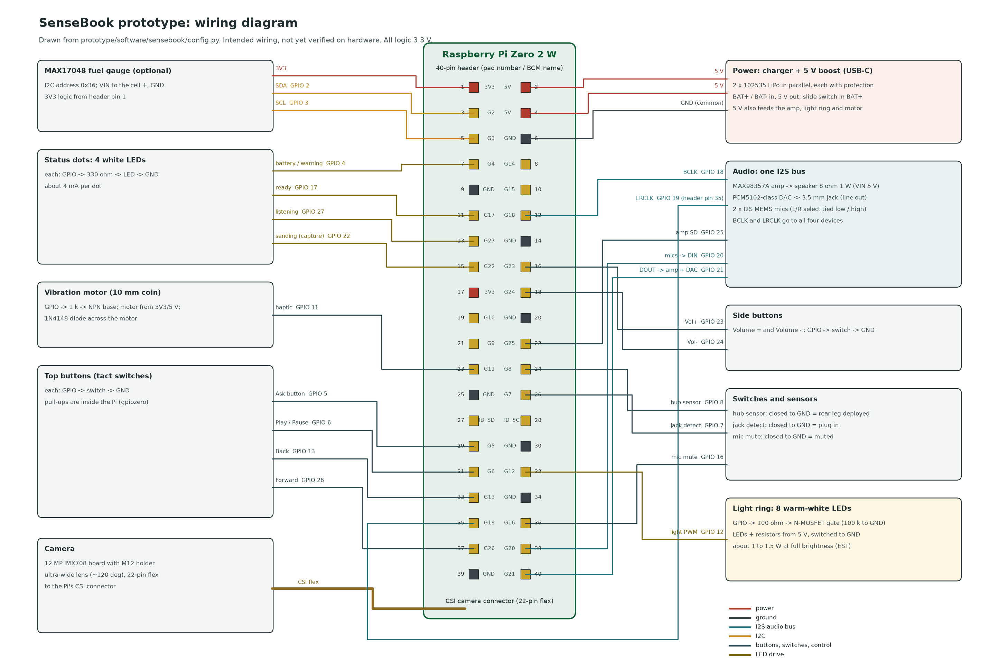
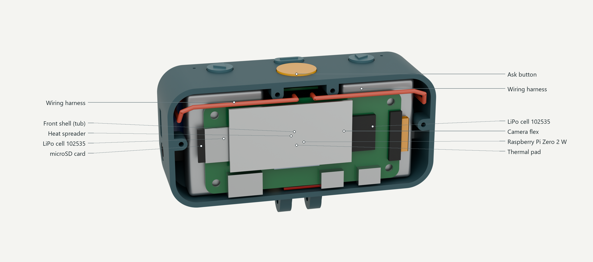
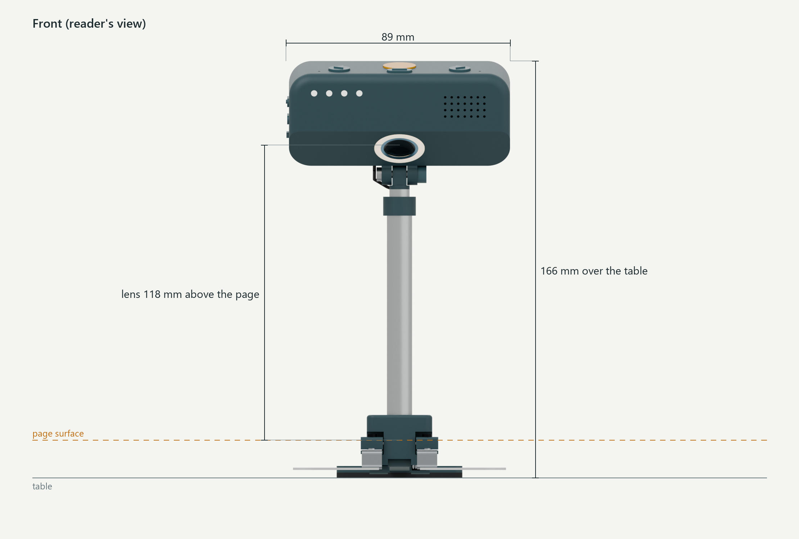

# SenseBook prototype: assembly guide

> **Status: written from the 3D model. No unit has been assembled yet.** Every step below follows the CAD model in `design/cad/` and is expected to change after the first build. Where a clearance is tight the step says so. Pictures are renders of the model, not photos.

Build one unit on the bench first, with the electronics working outside the case (step 1), before you close anything.

## What you need

- The parts in [Prototype_BOM.md](Prototype_BOM.md) and the printed parts in [3D-print notes](../../design/cad/out/PRINT_NOTES.md).
- Soldering iron with a fine tip, 0.5 mm solder, flux, 30 AWG silicone wire in six colours, heat-shrink.
- Drill bits 1.6, 2.0, 2.4, 3.0 and 10 mm; small files; a 2 mm hex or cross driver for M2 and M3.
- Tin snips or a rotary tool for the spring-steel blades; pliers and a vice for the two bends.
- Double-sided foam tape (1 mm), Kapton tape, clear glue, thread-lock.
- A multimeter and a USB power meter.

**Battery safety.** LiPo cells can catch fire if shorted, punctured or overcharged. Use cells with their own protection board, never solder with the cells connected, insulate every joint, and charge the first few times on a fireproof surface while you watch.

## 1. Bring the electronics up on the bench

Do this before any assembly. It finds wiring and software faults while everything is still easy to reach.

1. Flash the SD card and set up the Pi as in [the software README](../software/README.md).
2. Wire the parts with long leads, following the [pin map](pinmap.md) and the wiring diagram below. Power from the charger + boost board, not from the Pi's USB port.
3. Run the bench checks in sections B to D of the [test checklist](Test_Checklist.md).

## 2. Prepare the printed parts

1. Print the 18 parts listed in the print notes. Remove supports and check that the back cover drops into the front shell without force.
2. Drill the holes to size (they print small): 1.6 mm for the screw bosses, 2.0 mm for the leg hinge, 1.6 mm for the blade knuckle pin, 3.0 mm for the tilt pivot, 10.1 mm for the stick bore in the hub.
3. Test-fit every button cap in its hole. Each must drop back under its own weight.

## 3. Stick and tri-grip

1. **Tubes.** Cut the 10 mm tube to 103.5 mm and the 8 mm tube to 106.5 mm. Deburr inside and out. Press the glide bush on the bottom of the 8 mm tube.
2. **Cord.** Wind the 2-wire cord into a loose coil of about 20 turns, 5 mm across, and feed it through the 8 mm tube. Leave 60 mm free at each end.
3. **Joint head.** Push the joint head into the top of the 8 mm tube with a drop of glue. The cord leaves through the side of the head.
4. **Hub.** Glue the 10 mm tube into the hub bore until it stops. Slide the 8 mm tube in from the top and fit the twist-lock collar.
5. **Hub sensor.** Solder the cord to the detector switch and seat the switch in its pocket above the leg hinge.
6. **Rear leg.** Put the torsion spring on the leg barrel, place the leg in the hub and push the 2 mm pin through. One spring leg bears on the hub, the other on the leg. The spring must push the foot **down and forward**. Glue the TPU pad to the foot.
7. **Blades.** Cut two blades from 0.4 mm spring-steel shim using the DXF patterns (a left and a right). Round every edge and corner; nothing sharp may touch a page. Make the two bends on the marked lines (2 mm inside radius) so the blade steps down from the hub to the cover. Slide the coating or sleeve over the flat part.
8. **Knuckles.** Clamp each blade root in its knuckle with an M2 screw, seat both knuckles in the hub and push the 1.6 mm pin through both.

Check: the blades fold up along the stick, the leg swings from "up along the stick" to "forward under the hub", and the 8 mm tube pulls up with even friction.

## 4. Front shell

Work from the front wall backwards. The picture below shows where each part ends up.

1. **Lens opening.** Glue the light-ring diffuser into the 20 mm hole in the lens facet. Fit the clear window and the bezel ring. Push the four clear dot pipes into the front wall.
2. **Light-ring LED board.** Place it behind the diffuser, LEDs facing out, with its two wires leading up and back.
3. **Front wall parts.** Stick the speaker behind its grille (foam tape as a gasket), the status-LED board behind the four dots, and the vibration motor to the wall beside the amp position.
4. **Audio boards.** Fix the MAX98357A amp and the headphone DAC on edge in the left front corner with foam tape, connectors facing up.
5. **Side parts.** Glue the volume switch board and the mic-mute slide switch to the left wall behind their openings. Fit the 3.5 mm jack to the right wall and the charger + boost board above it so its USB-C socket lines up with the slot.
6. **Top parts.** Drop the Ask, Play/Pause, Back and Forward caps into the top wall, then fix the three small switch boards under them. Glue the two microphones under their 1 mm ports.
7. **Camera.** Screw the lens into its holder until focus is roughly right (final focus in the test checklist). Screw the camera board to the four posts behind the lens opening. The lens must not touch the window.
8. **Fuel gauge.** Tape it to the floor of the shell behind the lens, under the camera.
9. **Cells.** Stand one cell on each side of the camera with foam tape on the back face. Fold each protection board onto the front face of its cell. **Clearance here is 1.4 mm in total at the cell ends: measure your cells first.**

## 5. Back cover and the Pi

1. Bond the aluminium heat spreader to the inside of the back cover and put the thermal pad on it where the Pi's main chip will sit.
2. Plug the camera flex into the Pi (contacts toward the board), fold it back around the end of the board and lay it flat along the Pi's underside.
3. Press the Pi onto the four locating pins, chips toward the cover. Melt the pin tips flat with the side of the soldering iron, or use a drop of glue.

## 6. Wiring

1. Solder the two harnesses to the pads on the underside of the Pi's GPIO edge, following the pin map. Keep the I2S wires (GPIO 18 to 21) short and twisted with a ground wire.
2. Route both harnesses up over the Pi's top edge, along the channel inside the back cover, down the two side walls and forward to the boards (see the cutaway below).
3. Join the two cells in parallel at the power board. Check polarity with the meter **before** connecting.
4. Plug the camera flex into the camera board.
5. Feed the hub cord up through the hole in the floor of the shell and solder it to GPIO 8 and ground.

## 7. Close and fit

1. Dress the wires so nothing lies over the screw bosses or under the button boards.
2. Lower the back cover on. The tongue should seat all round with no gap. Fit the four M2 x 8 screws.
3. Put the unit's two lugs over the joint head, push the M3 screw through and fit the thumb nut. Tighten until the unit holds its angle but can still be tipped by hand.

## 8. First power-on

Run sections C to I of the [test checklist](Test_Checklist.md), in order. Do not hand a unit to a tester until the battery, thermal and tip-over checks have passed.

## Known tight spots in this layout

These come from the model's clearance check (`design/cad/out/check_report.json`). They are the places most likely to need a change after the first build.

| Where | Clearance in the model | What to do |
|---|---|---|
| Cells, top and bottom | 1.4 mm in total for a 35.0 mm cell; 0.4 mm to the shell at the corners | Measure the real cells with their protection board. If they are longer than 36 mm the shell must grow or the cells change. |
| Camera board to the Pi, and to each cell | 1.2 mm to the Pi at the lower edge; 0.6 mm to each cell | Use a board no larger than 24 x 25 mm, or move the posts. |
| Pi connectors to the back cover | 0.1 mm | File the cover if the HDMI shell touches. |
| Wiring harness past the top cover screws | 0.1 mm | Keep the harness thin (30 AWG) and tied flat. |
| Thumb nut to the underside of the unit | 0.5 mm | Use a nut no larger than 7 mm across. |

See [design/VALIDATION.md](../../design/VALIDATION.md) for the full list of open risks.
