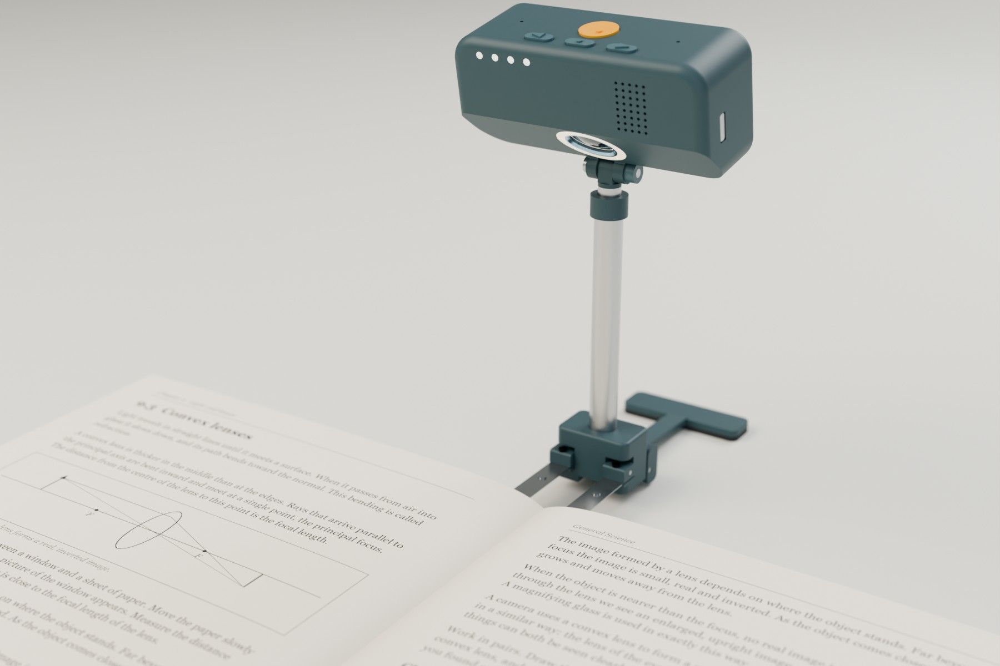
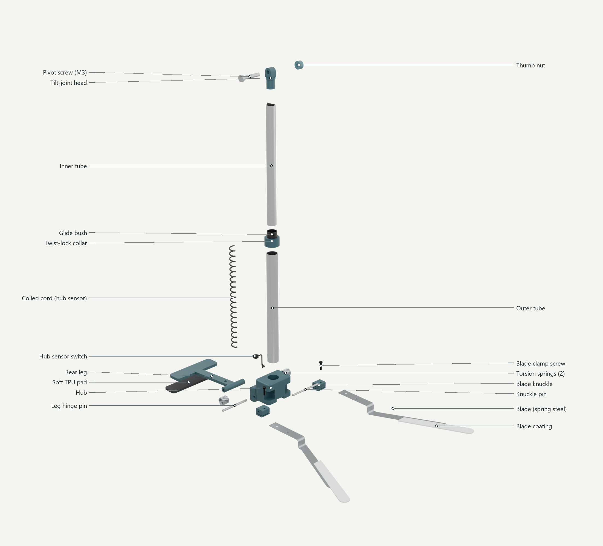
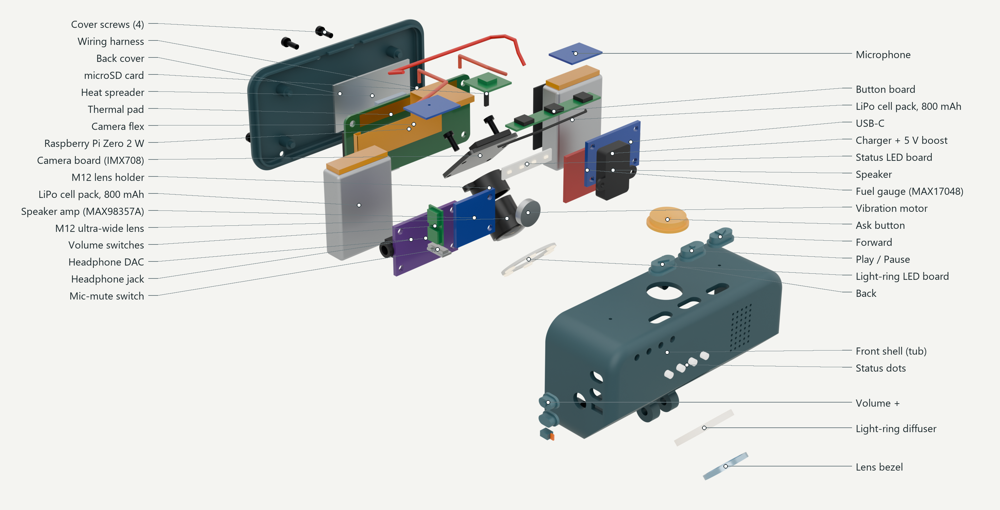
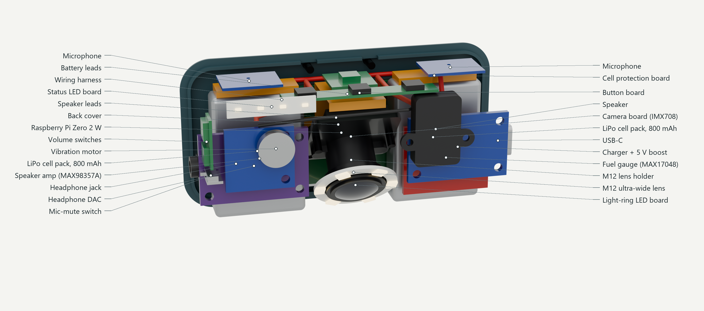
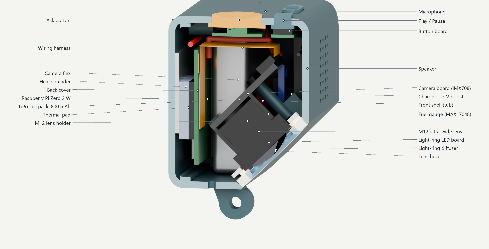

# SenseBook prototype: assembly guide

> **Status: written from the 3D model. No unit has been assembled yet.** Every step below follows the CAD model in `design/cad/`, which is drawn around real parts at their published sizes (see [SOURCES.md](../../design/cad/SOURCES.md)). Steps will change after the first build. Pictures are renders of the model, not photos.

Build one unit on the bench first, with the electronics working outside the case (step 1), before you close anything.

## What you need

- The parts in [Prototype_BOM.md](Prototype_BOM.md) and the printed parts in the [3D-print notes](../../design/cad/out/PRINT_NOTES.md). Every part has a [dimensioned drawing](../../design/drawings/SenseBook_drawings.pdf).
- Calipers. **Measure the bought parts before you print**: 25 sizes in the model are estimates because no maker publishes them. They are listed at the end of [SOURCES.md](../../design/cad/SOURCES.md) with how to measure each one.
- Soldering iron with a fine tip, 0.5 mm solder, flux, 30 AWG silicone wire in six colours, heat-shrink.
- Drill bits 1.6, 1.7, 2.0, 2.1, 2.4, 3.1, 3.2 and 10.1 mm; small files; a cross driver for the ST2.2 and M2 screws and a hex key for the M3.
- Tin snips or a rotary tool for the spring-steel blades; pliers and a vice for the two bends.
- Double-sided tape (0.1 mm), 0.7 mm foam tape, Kapton tape, clear glue, thread-lock.
- A multimeter and a USB power meter.

**Battery safety.** LiPo cells can catch fire if shorted, punctured or overcharged. Use packs with their own protection board, never solder with the cells connected, insulate every joint, and charge the first few times on a fireproof surface while you watch.

## 1. Bring the electronics up on the bench

Do this before any assembly. It finds wiring and software faults while everything is still easy to reach.

1. Flash the SD card and set up the Pi as in [the software README](../software/README.md).
2. Wire the parts with long leads, following the [pin map](pinmap.md) and the wiring diagram below. Power from the charger + boost board, not from the Pi's USB port.
3. Run the bench checks in sections B to D of the [test checklist](Test_Checklist.md).

## 2. Prepare the printed parts

1. Print the 18 parts listed in the print notes. Start with the two shells and the hub: they carry almost every fit (see "what to print first" in [VALIDATION.md](../../design/VALIDATION.md)).
2. Remove supports and check that the back cover drops into the front shell without force. The cover tongue is drawn 0.15 mm clear of the wall.
3. Drill the holes to size (they print small): 1.7 mm for the six screw pilots, 2.0 mm for the leg hinge in the hub and 2.1 mm in the leg barrel, 1.6 mm for the knuckle pin in the hub and 1.7 mm in the knuckles, 3.1 mm for the tilt pivot in the joint head and 3.2 mm in the lugs, 10.1 mm for the stick bore in the hub.
4. Test-fit every button cap in its opening. Each must drop back under its own weight. They are drawn 0.15 mm clear per side.

## 3. Stick and tri-grip

1. **Tubes.** Cut the 10 mm tube to 103.5 mm and the 8 mm tube to 105.5 mm. Deburr inside and out. File a notch 1.2 mm wide and 1.2 mm high in the foot of the 10 mm tube: the sensor lead comes in through it. Press the glide bush on the bottom of the 8 mm tube.
2. **Cord.** Wind the 2-wire cord (0.9 mm across) into a loose coil of about 20 turns, 5.5 mm across. Feed it through the 8 mm tube.
3. **Joint head.** Thread the top end of the cord up the 1.7 mm hole in the middle of the joint head and out through the slot at the back of its collar. Push the head into the top of the 8 mm tube with a drop of glue. Leave about 70 mm of cord free.
4. **Hub sensor.** Solder two leads to the detector switch board and seat it in its pocket behind the stick bore. Press the leads into the 1.2 mm groove: sideways, down beside the bore, forward at the foot.
5. **Hub.** Glue the 10 mm tube into the hub bore with its notch over the end of the groove. Bring the leads in through the notch, join them to the bottom of the coil, and slide the 8 mm tube in from the top. It stops 2 mm above the foot of the outer tube so it does not pinch the leads. Fit the twist-lock collar.
6. **Rear leg.** Put one torsion spring on each end of the leg barrel, place the leg in the hub and push the 2 mm pin through. Trim and bend the spring legs so one bears on the hub and the other on the leg arm. The springs must push the foot **up toward the book** and should only start to act once the leg has swung past about 110 degrees, with roughly 20 degrees of wind already in them. **The seats for the spring legs are not drawn in the model: work them out on the first hub and tell us what worked.** Glue the TPU pad to the foot.
7. **Blades.** Cut two blades from 0.4 mm spring-steel shim using the DXF patterns (a left and a right). Round every edge and corner; nothing sharp may touch a page. Make the two bends on the marked lines so the blade steps down from the hub to the cover. Slide the coating or sleeve over the flat part.
8. **Knuckles.** Clamp each blade root in its knuckle with an M1.6 screw, seat both knuckles in the hub and push the 1.6 mm pin through both.

Check: the blades fold up along the stick, the leg swings from "up along the stick" to "forward under the hub" and presses the sensor plunger only when it is folded away, and the 8 mm tube pulls up with even friction without tugging the leads.

## 4. Front shell

Work from the front wall backwards. The picture below shows where each part ends up.

1. **Lens opening.** Glue the light-ring diffuser into the 24 mm hole in the lens facet, and the bezel ring inside the diffuser. There is no window: the lens front will sit in the bezel, 0.4 mm inside the surface. Push the four clear dot pipes into the front wall.
2. **Light-ring LED board.** Place it behind the diffuser, its six LEDs facing out, with its two wires leading up and back.
3. **Front wall parts.** Stick the speaker behind its grille with a thin line of tape or glue, the status-LED board behind the four dots, and the vibration motor to the wall with its own adhesive pad.
4. **Left wall (the reader's left).** Fit the two volume caps and the mute slider cap from inside, then glue the volume switch board and the mute switch board behind them; the slider cap grips the switch lever. Stand the DAC board against this wall so the nose of its headphone jack sits in its hole. Stand the amp board in front of it.
5. **Right wall.** Stand the charger board against the wall so its USB-C socket sits in its opening. Stand the fuel gauge behind it. **Take the two sockets off the fuel gauge first** and solder wires to it: as sold it is 7.2 mm tall and does not fit.
6. **Top.** Drop the Ask, Back, Play/Pause and Forward caps into the top wall, then fix the two switch boards under them. Glue the two microphone boards flat under the top with the hole in each board over its 1.2 mm port.
7. **Camera.** Screw the lens into its holder until focus is roughly right (final focus in the test checklist). Seat the lower edge of the camera board in the notches of the two cradle ribs and fix the upper edge to the two posts with two ST2.2 screws. The lens rim must sit centred in the bezel with about 0.2 mm all round.
8. **Cells.** Stand one pack on each side of the camera, protection board at the top, leads leaving upward, with a strip of 0.7 mm foam on the back face. The pocket is drawn for a pack up to 10.5 x 26 x 37.5 mm. **Measure your packs first.**

## 5. Back cover and the Pi

1. Bond the aluminium heat spreader to the inside of the back cover. Measure the height of the Pi's main chip and choose a thermal pad that fills the gap to the spreader (2.5 mm in the model; the chip height is an estimate).
2. Plug the camera flex into the Pi (contacts toward the board), fold it back around the end of the board and lay it flat along the Pi's underside. Fold the spare length (about 70 mm of the 150 mm cable) flat over a 1 mm rod. Do not crease it.
3. Press the Pi onto the four locating pins, chips toward the cover. There are no screws here: the cells sit right behind the board. Melt the pin tips flat with the side of the soldering iron, or use a drop of glue.

## 6. Wiring

Cut lengths are from the model's cable routes ([fit report](../../design/cad/out/FIT_REPORT.md), section 5). Add 15 mm to each for the bends and the joints.

| Run | Length in the model |
|---|---|
| Left harness: Pi to the amp, DAC, buttons, LEDs, motor | 40 mm |
| Right harness: Pi to the charger and fuel gauge | 33 mm |
| Battery leads: both packs to the charger board | 85 mm in all |
| Speaker leads from the amp | 43 mm |
| Hub cord inside the unit: bottom hole to the Pi | 51 mm |

1. Solder the two harnesses to the pads on the underside of the Pi's GPIO edge, following the pin map. Keep the I2S wires (GPIO 18 to 21) short and twisted with a ground wire.
2. Route both harnesses up over the Pi's top edge and forward to the boards (see the cutaway below).
3. Join the two packs in parallel at the charger board. Check polarity with the meter **before** connecting.
4. Plug the camera flex into the camera board.
5. Feed the hub cord up through the 2 mm hole in the bottom of the shell, between the two lugs, run it up between the cells behind the camera, and solder it to GPIO 8 and ground. The model's switch closes when the rear leg is folded away, so the input needs a pull-up and the software setting `hardware.hub_active_low` must match (see the pin map).

## 7. Close and fit

1. Dress the wires so nothing lies over the screw bosses or under the button boards.
2. Lower the back cover on. The tongue should seat all round with no gap. Fit the four ST2.2 x 6.5 screws.
3. Put the unit's two lugs over the joint head, push the M3 screw through and fit the thumb nut. Tighten until the unit holds its angle but can still be tipped by hand. Leave a small loop of cord between the joint head and the unit so it does not pull tight when the unit tilts.

## 8. First power-on

Run sections C to I of the [test checklist](Test_Checklist.md), in order. Do not hand a unit to a tester until the battery, thermal and tip-over checks have passed.

## Places to watch on the first build

The model has no clashes and every gap between parts that must not touch is at least 0.3 mm. These are still the places most likely to need a change, because a print is only good to about 0.2 mm and some part sizes are estimates.

| Where | In the model | What to do |
|---|---|---|
| Fuel gauge | Fits only with its two sockets removed (2.8 mm tall, an estimate; 7.2 mm as sold) | Desolder the sockets, then measure |
| DAC board against the left wall and the volume cap | 0.3 mm to the wall, 0.3 mm to the lip of the lower volume cap | Check the board is 30.48 x 20.32 mm; file the cap lip if it rubs |
| Headphone jack nose in its hole | 0.2 mm all round; the jack size is an estimate | Measure the jack, open the hole to suit |
| Sensor lead under the inner tube | 2 mm of height at the foot of the stick for a 0.9 mm lead | Check the lead is not pinched when the stick is pushed fully down |
| Cord at the tilt joint | About 10 mm of free cord bends every time the unit tilts | Leave a loop; add a dab of flexible glue where it leaves the joint head |
| Cell packs | Pocket 10.5 thick; 3.5 mm above the packs for the leads | Measure the packs with their protection board |
| Pi connector and chip heights | Estimates (not on the Raspberry Pi drawing) | Measure; the thermal pad thickness depends on the chip height |
| Camera flex | 71 mm of spare cable to fold away behind the Pi | Fold over a rod, tape flat |

See [design/VALIDATION.md](../../design/VALIDATION.md) for the full list of open risks.
