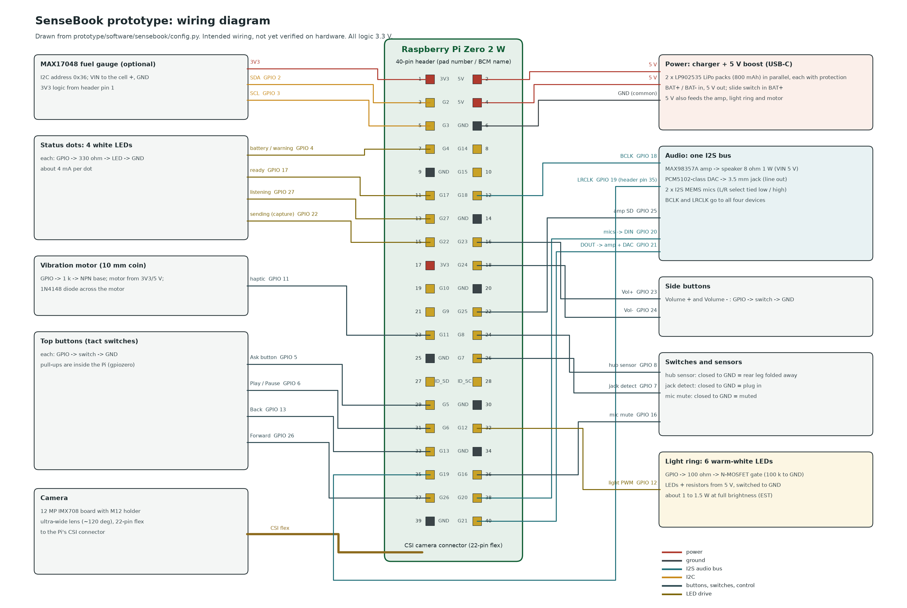

# SenseBook prototype: pin map

> **Generated** by `make_hardware_docs.py` from `prototype/software/sensebook/config.py`, the table that `hardware.py` uses. Do not edit by hand: change `config.py` and run the script again.
> **Status:** intended wiring for the first bench build. Not yet verified on hardware.

Board: Raspberry Pi Zero 2 W, 40-pin header (solder wires to the pads; no pin header fits in the unit). All logic is 3.3 V. BCM = the GPIO number used in the code.

| Header pin | BCM GPIO | Function | Wiring | Key in `config.py` |
|---|---|---|---|---|
| 3 | 2 | I2C data | MAX17048 SDA (address 0x36), optional | `sda` |
| 5 | 3 | I2C clock | MAX17048 SCL, optional | `scl` |
| 7 | 4 | Status dot: battery / warning | LED + 330 ohm to GND | `dot_warn` |
| 11 | 17 | Status dot: ready | LED + 330 ohm to GND | `dot_ready` |
| 12 | 18 | I2S bit clock | to both mics, MAX98357A BCLK, DAC BCK | `bclk` |
| 13 | 27 | Status dot: listening | LED + 330 ohm to GND | `dot_listening` |
| 15 | 22 | Status dot: sending (capture) | LED + 330 ohm to GND | `dot_sending` |
| 16 | 23 | Volume + (hold = faster) | switch to GND, internal pull-up | `vol_up` |
| 18 | 24 | Volume - (hold = slower) | switch to GND, internal pull-up | `vol_down` |
| 22 | 25 | Amp enable (MAX98357A SD) | direct; low = amp off | `amp_enable` |
| 23 | 11 | Vibration motor | base of an NPN (or MOSFET gate) with 1 k, flyback diode across the motor | `haptic` |
| 24 | 8 | Hub sensor | detector switch to GND while the rear leg is folded away; open (pin high) when the leg is deployed; internal pull-up | `hub_attached` |
| 26 | 7 | Headphone jack detect | jack switch to GND when a plug is in, internal pull-up (needs a jack with a detect contact) | `jack_detect` |
| 29 | 5 | Ask button (hold to talk) | switch to GND, internal pull-up | `ask` |
| 31 | 6 | Play / Pause (hold = where am I) | switch to GND, internal pull-up | `play_pause` |
| 32 | 12 | Light ring, PWM | gate of an N-MOSFET (AO3400-class), 100 ohm in series, 100 k to GND | `light` |
| 33 | 13 | Back (hold = repeat) | switch to GND, internal pull-up | `back` |
| 35 | 19 | I2S word select (LRCLK) | to both mics WS, MAX98357A LRC, DAC LCK | `lrclk` |
| 36 | 16 | Mic-mute slide switch | closed to GND = muted, internal pull-up | `mic_mute` |
| 37 | 26 | Forward | switch to GND, internal pull-up | `forward` |
| 38 | 20 | I2S data into the Pi | from both mics SD (one L, one R) | `din` |
| 40 | 21 | I2S data out of the Pi | to MAX98357A DIN and DAC DIN | `dout` |

## Power and ground

| Header pin | Net | Goes to |
|---|---|---|
| 2, 4 | 5 V | 5 V out of the charger + boost board (the only supply into the Pi) |
| 1, 17 | 3.3 V (from the Pi) | I2S mics, headphone DAC logic, MAX17048 pull-ups; about 50 mA spare in total (EST) |
| 6, 9, 14, 20, 25, 30, 34, 39 | GND | common ground: boost board, audio boards, every switch and LED |

The MAX98357A is powered from 5 V (boost output), not from the Pi's 3.3 V pin. The light ring and the vibration motor also take their current from 5 V or the battery through their transistors, never from a GPIO pin.

## Camera

22-pin 0.5 mm CSI connector on the Pi Zero 2 W to the 15-pin 1 mm connector on the camera board (Arducam B0310), using a 150 mm Pi Zero camera cable. The route in the model is 79 mm; the rest is folded flat behind the Pi.

## Things to watch on the bench

- **GPIO 4** (battery / warning dot) has a pull-up at boot. The LED may glow faintly until the app starts. If it does, move the resistor to 1 k or add a 10 k pull-down.
- **GPIO 7 and 8** are the SPI chip-select pins and **GPIO 11** is SPI clock. Keep SPI off (`dtparam=spi=off`, the default) or these inputs and the motor pin will be driven by the kernel.
- **GPIO 12** is PWM0, also used by the Pi's analogue audio. `dtparam=audio=off` is required (it is in the audio set-up).
- **GPIO 16** is the default shutdown pin of the `googlevoicehat-soundcard` overlay. Use the modified overlay from `prototype/software/docs/AUDIO.md`, or the mic-mute switch will fight the sound driver.
- **GPIO 2 and 3** have fixed 1.8 k pull-ups on the board: do not add more on the fuel-gauge breakout.
- **Hub sensor polarity.** In the 3D model the detector switch (Alps SPVE110200) is pressed while the rear leg is folded away, so GPIO 8 is low when the device is stowed and high when the leg is out. The software default `hardware.hub_active_low: true` reads it the other way round: set it to `false` in `config.yaml` for this build, and check on the bench that "attached" is announced when the leg swings out.
- **Headphone detect.** The DAC board drawn in the model (Adafruit 6250) carries its own 3.5 mm jack. We could not confirm that this jack has a plug-detect contact. If it has none, GPIO 7 stays unconnected and headphones must be chosen another way, or a switched jack is fitted instead (for example CUI SJ-3524-SMT).
- **Supply current.** The charger board drawn in the model (Adafruit 6106, bq25185) is listed at 1 A on its 5 V output. Measure the peak draw with the speaker loud, the light ring on and the camera capturing (test B5 and B6) before trusting it.
- The I2S clock lines go to four devices. Keep those wires short (under 8 cm) and twist each with a ground wire.

