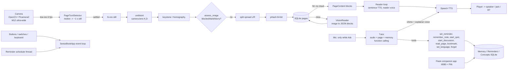

# SenseBook software architecture

## Pipeline


Providers (`sensebook/providers`): `VisionReader`, `Tutor`, `Speech` ABCs; `gemini.py` and `mock.py`. `make_providers()` is the only place a vendor is named.

Threads: main event loop; camera loop; reader loop (+1 TTS prefetch worker); scheduler (5 s tick); discussion/quiz threads; 2-worker pool for Ask handling and page reads; Flask.

## Seamless page flipping
```
low-res frames -> PageTurnDetector.feed_event -> hand_in | hand_out | settled_changed | settled_same
hand_in          -> duck / stop speech, hold reading position (read_idx = interrupted sentence)
settled_same     -> unduck, resume the held sentence
settled_changed  -> capture still -> hand re-check (discard if hand) -> rectify (quad | fixed homography)
                 -> split L/R -> pHash -> cache|cloud -> _install_spread(kind = first|same|forward|back|skip)
                 -> announce back/skip -> start_reading(start)   [auto-continue if read_mode]
reader loop      -> TTS futures keyed by (text, lang, speed); _preload_next warms spread N+1 (cache successor)
```
State: `history` (browser-style stack of spread keys), `positions` (key -> sentence), `read_mode` (user is in read mode; cleared by
pause, Ask, reminders, quiz/discussion). Hand cues: skin-tone area above a slowly tracked baseline touching an edge, or a motion
blob > `hand_motion_fraction` touching an edge. Limits: skin test assumes paper is not skin-toned (cream/white/grey are fine);
hand over a cream page that arrives slowly is caught only by the still re-check; dark desk assumed for quad detection (else fixed homography).

## Final hardware (software view)
```
still -> Undistorter (fisheye|standard, K,D from calibrate_camera.py) -> rectify_page (page quad | fixed homography) -> split
GPIO: buttons(Ask hold-to-talk; Play/Pause, Vol+, Vol-, Back: act on release, or on hold: where-am-I / speed / repeat), Forward,
      mic-mute 16, jack-detect 7, hub sensor 8, dots 17/27/22/4, light 12 (PWM), amp SD 25, haptic 11; I2C 2/3 fuel gauge (optional)
events: headphones_in/out -> AudioRouter.jack_in -> amp SD low + "Headphones";  attached/detached -> guidance state `attach_pending`
amp: Player.pre_play wakes SD; amp_tick() lowers it after audio.amp_idle_seconds; never raised while headphones are in
```
Attach guidance runs on the first captured spread after a hub attach (`page_framing` on the undistorted image, vision `orientation`).

## Modules
`camera` detector (hand + turn)/backends/splitter/quality; `perspective` keystone correction; `pages` pHash, blocks, sentence split, page cache; `providers`; `tutor` tool schema + dispatch;
`audio` WAV, player, recorders, offline TTS, `AudioRouter`; `memory`; `reminders`; `quiz` (SM-2 + spoken flow); `discussion`;
`hardware` (gpiozero / keyboard / null); `webapp`; `app` (wiring and modes); `captures`; `messages` (bn/en system phrases).

## Data model (one SQLite file, WAL)
```
profile(key, value)                         language, level, voice_speed, memory_enabled, headphone_pref, light_level, current_book, pin_hash (PBKDF2)
notes(id, text, created)                    -- opt-in
concepts(name PK, mastery, ease, interval_days, repetitions, due, last_review, source_page)   -- SM-2 state, opt-in
sessions(id, started, ended, pages_read, seconds)                                             -- opt-in
bookmarks(id, book, page_id, label, created)                                                  -- opt-in
quiz_results(id, ts, quiz_id, question, qtype, concept, expected, answer_heard, score, feedback) -- opt-in
reminders(id, message, next_fire UTC, repeat none|daily|weekly, active, created, last_fired)   -- always allowed
pages(id, phash, book, page_label, lang, confidence, blocks_json, first_seen, last_seen, seen_count)  -- page cache / library
```

## Key decisions
- **Faithful vs interpreted**: reader voice + no chime = text printed on the page; chime + explainer voice = AI. Vision prompt forbids correcting/guessing; unreadable characters become the placeholder `‹?›`, spoken as "unclear". Pages below `pages.min_confidence` are never cached or read.
- **Offline**: page cache is consulted before any cloud call; unseen pages offline give a spoken message; TTS falls back to espeak-ng/pyttsx3.
- **Quiz grading** sends the spoken answer audio to the model (no separate STT), SM-2 quality = round(score x 5).
- **Spaced repetition** feeds a "review due" notice at start-up and hourly.
- **Time**: all schedule arithmetic in UTC with `Asia/Dhaka` wall-clock repeats; injectable clock for tests.

## Privacy
- **Cloud**: only page images (while the capture LED is lit), Ask audio (only while Ask is held/active), page text and context text go to Gemini. Nothing is sent while the mic-mute switch is on (recording is blocked in software and "microphone off" is announced).
- **Local**: memory is off until a guardian enables it; the SQLite file never leaves the device. Page images and audio are *not* kept unless `storage.keep_captures: true` (stored only in `data/captures`, purge with `--purge-captures`). Export (JSON) and delete-everything are available by web app (PIN) and by voice (physical confirmation: Forward button within 10 s).
- **Access**: web app is PIN-gated (PBKDF2, lockout after 5 failures, CSRF tokens, CSP, no external assets), binds to `127.0.0.1` in dev and to the LAN only in device mode. It is plain HTTP on the LAN: do not expose it beyond the home network.
- **Secrets**: `GEMINI_API_KEY` only from `.env`, redacted from error text. Page text of NCTB books is copyrighted material stored locally as a cache only.
- **Gaps**: no TLS; no per-user profiles (one learner per device); the tutor prompt includes notes you saved, so Google's data terms apply to them. Check the paid-tier data-use terms of the Gemini API before deploying with minors' data.
